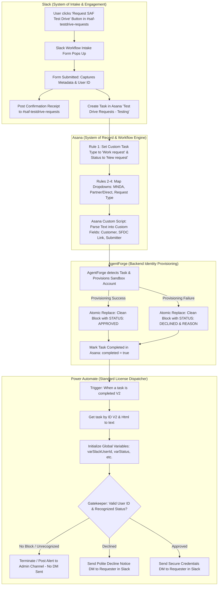

# SAF Test Drive Requests: Technical Architecture & System Specification

## 1. Executive Summary & Objective

The **SAF Test Drive Requests** automation pipeline is a cross-platform enterprise integration connecting **Slack**, **Asana**, **AgentForge (Backend Provisioning)**, and **Microsoft Power Automate**.

Its primary business objective is to streamline the intake, governance, provisioning, and delivery of temporary, read-only demo environments (tenants) for SailPoint's Secure Agent Framework (SAF) / Entro product lines for Go-To-Market (GTM) teams, Solutions Engineering, and Partners.

### Core Architectural Guarantees

* **Least Privilege & Zero-Trust Delivery:** Sensitive credentials (sandbox account, passwords, tenant links) are never posted to public or shared Slack channels; they are dispatched strictly via private 1-on-1 Slack Direct Messages (DMs).
* **Standard Licensing Compliance:** Operates completely on Microsoft Power Automate Standard connectors (Office 365 / Slack Standard), requiring zero Premium licenses, custom HTTP webhooks, or third-party middleware (e.g., Zapier/Workato).
* **Zero Custom Slack App / Bot Overhead:** Leverages pre-approved enterprise connectors and native Slack Workflow Builder features, avoiding unapproved custom `xoxb-` bot token dependencies.
* **Defensive Failure Handling:** Enforces strict 3-state validation (`APPROVED`, `DECLINED`, `NO_BLOCK`). If metadata or user identity parsing fails, execution halts safely with an admin alert rather than leaking secrets or misrouting credentials.
* **Bounded Data Envelopes:** Implements opening and closing block boundaries (`--- FULFILLMENT DETAILS ---` and `--- END FULFILLMENT DETAILS ---`) so that manual comments, line wraps, or trailing notes cannot corrupt parsed credentials.

---

## 2. End-to-End System Architecture



---

## 3. Component Breakdown & Responsibilities

| Component | Role | Trigger / Method | Key Artifacts / IDs |
| :--- | :--- | :--- | :--- |
| **Slack Intake Workflow** | Entry point, intake validation, public receipt | Link / Shortcut trigger (`https://slack.com/shortcuts/...`) | Channel `#saf-testdrive-requests` (`C0CFXQTLT6Y`), Workflow Icon: Cyber Shield |
| **Asana Project Board** | Central system of record, operational tracking | Native Asana Rules & Scripting | Project: `Test Drive Requests - Testing` (Target Prod: `Test Drive Requests`) |
| **Asana Automation Rules** | Structural state setup & dropdown mapping | `Task added to project` | Custom Task Type: `Work request`, Status: `New request` |
| **Asana Script (`run()`)** | Dynamic regex metadata parser | `Task added to project` | node-asana v3 SDK parameter sequence |
| **AgentForge** | Autonomous sandbox tenant provisioning | Asana task listener / API poll | Atomically writes bounded `--- FULFILLMENT DETAILS ---` block & marks task complete |
| **Power Automate Flow** | Event router, defensive validator & private DM dispatcher | `When a task is completed (V2)` | Flow: `SAF - Fulfillment Thread Reply & DM` |

---

## 4. Slack Workflow Builder Configuration

* **Workflow Name:** `SAF Test Drive Requests`
* **Trigger:** **Starts from a link in Slack** (`https://slack.com/shortcuts/Ft0CFCS1JXHV/61952`)
* **Trigger Placement:** Pinned inside `#saf-testdrive-requests` (`C0CFXQTLT6Y`) on the **Channel Canvas** and the **Bookmark Bar** as an action button: `🟢 Request SAF Test Drive`.

### Step 1: Collect info in a form
* **Title:** `SAF Test Drive Request`
* **Target:** `Person who clicked the link`
* **Form Fields:**
  1. `Customer` (Short Text, Required) — Full company name as listed in SFDC.
  2. `Customer Email Address(es)` (Short Text, Required) — Comma-separated admin emails (Max 3).
  3. `Link to SFDC Opportunity` (Short Text, Required) — SFDC Opportunity URL.
  4. `Is this Test Drive for a customer directly or through a partner?` (Dropdown: `Customer`, `Partner`)
  5. `Has a SailPoint MNDA or Eval Agreement been signed?` (Dropdown: `Yes`, `No`)
  6. `Is this a net-new provisioning request, or an extension request for an existing Test Drive?` (Dropdown: `New request`, `Extension`)

### Step 2: Create a task (Asana Integration)
* **Workspace:** `SailPoint Technologies`
* **Project:** `Test Drive Requests - Testing` (Move to production upon cutover)
* **Task Name:** `SAF Test Drive Request - {Answer to: Customer}`
* **Description Template (`notes`):**
```text
A new SAF Test Drive Request has been submitted!

Requester: {Person who used this workflow}
Prospect/Customer: {Answer to: Customer}
Main Contact Email(s): {Answer to: Customer Email Address(es)}
SFDC Opportunity Link: {Answer to: Link to SFDC Opportunity}
Test Drive Type: {Answer to: Is this Test Drive for a customer directly or through a partner?}
MNDA Signed?: {Answer to: Has a SailPoint MNDA or Eval Agreement been signed?}
Request Type: {Answer to: Is this a net-new provisioning request, or an extension request for an existing Test Drive?}

Slack User ID: {Person who used this workflow (User ID)}

This task was submitted through SailPoint SAF Test Drive Request.
```

### Step 3: Send a message to a channel
* **Channel:** `#saf-testdrive-requests` (`C0CFXQTLT6Y`)
* **Message Text:**
```text
🎉 *SAF Test Drive Request Submitted!*
Thank you <@{Person who used this workflow}>. Your request has been logged in Asana and provisioning has started.

🔒 *Next Steps:* Once your test drive environment is ready, your credentials, account, and tenant link will be sent directly to your *Direct Messages (DMs)* for security.

*Request Details:*
• *Customer:* {Answer to: Customer}
• *MNDA Signed?:* {Answer to: Has a SailPoint MNDA or Eval Agreement been signed?}
• *Type:* {Answer to: Is this a net-new provisioning request, or an extension request for an existing Test Drive?}
```

---

## 5. Asana Workflow Architecture & Custom Scripting

### Asana Native Visual Rules
* **Rule 1 (`SAF - Initialize Work Request Status`):**
  * *Trigger:* `Task added to this project`
  * *Actions:* `Change task type` ➔ `Work request` THEN `Set Work request status` ➔ `New request`.
* **Rule 2 (`SAF - Map MNDA Signed Status`):**
  * *Trigger:* `Task added to this project`
  * *Branch 1:* Description contains `MNDA Signed?: Yes` ➔ Set `MDNA signed?` = `Yes`
  * *Branch 2:* Description contains `MNDA Signed?: No` ➔ Set `MDNA signed?` = `No`
* **Rule 3 (`SAF - Map Partner or Direct`):**
  * *Trigger:* `Task added to this project`
  * *Branch 1:* Description contains `Test Drive Type: Customer` ➔ Set `Test Drive Partner or Direct` = `Customer`
  * *Branch 2:* Description contains `Test Drive Type: Partner` ➔ Set `Test Drive Partner or Direct` = `Partner`
* **Rule 4 (`SAF - Map New or Extension`):**
  * *Trigger:* `Task added to this project`
  * *Branch 1:* Description contains `Request Type: New request` ➔ Set `New or extension` = `New request`
  * *Branch 2:* Description contains `Request Type: Extension` ➔ Set `New or extension` = `Extension`

### Asana Custom Script: Metadata Parser
* **Rule Name:** `SAF - Parse Slack Metadata & Populate Fields`
* **Trigger:** `Task added to this project`
* **Action:** `Run script`
* **Runtime:** Node.js (node-asana v3 SDK)

```javascript
/**
 * SAF - Parse Slack Metadata & Populate Fields
 * Uses node-asana v3 parameter order: updateTask(body, target_gid)
 */
async function run() {
  if (target_type === "Task") {
    const task = await tasksApiInstance.getTask(target_gid);
    const description = task.data.notes || "";

    log("Successfully retrieved task notes. Beginning metadata extraction...");

    const requesterRegex = /Request[eo]r:\s*(.+)/i;
    const customerRegex = /Prospect\/Customer:\s*(.+)/i;
    const emailRegex = /Main Contact Email\(s\):\s*(.+)/i;
    const sfdcRegex = /SFDC Opportunity Link:\s*(.+)/i;

    const parsedRequester = (description.match(requesterRegex)?.[1] || "").trim();
    const parsedCustomer = (description.match(customerRegex)?.[1] || "").trim();
    const parsedEmail = (description.match(emailRegex)?.[1] || "").trim();
    const parsedSFDCLink = (description.match(sfdcRegex)?.[1] || "").trim();

    const customFieldsPayload = {};
    const taskCustomFields = task.data.custom_fields || [];

    const findFieldGidByName = (name) => {
      const field = taskCustomFields.find(
        (f) => f.name && f.name.trim().toLowerCase() === name.trim().toLowerCase()
      );
      return field ? field.gid : null;
    };

    const submitterGid = findFieldGidByName("Submitter Name");
    const customerGid = findFieldGidByName("Customer/Partner/Event");
    const emailGid = findFieldGidByName("Main Contact Email");
    const sfdcGid = findFieldGidByName("SFDC Link");

    if (submitterGid && parsedRequester) customFieldsPayload[submitterGid] = parsedRequester;
    if (customerGid && parsedCustomer) customFieldsPayload[customerGid] = parsedCustomer;
    if (emailGid && parsedEmail) customFieldsPayload[emailGid] = parsedEmail;
    if (sfdcGid && parsedSFDCLink) customFieldsPayload[sfdcGid] = parsedSFDCLink;

    if (Object.keys(customFieldsPayload).length > 0) {
      log("Updating custom fields payload: " + JSON.stringify(customFieldsPayload));

      await tasksApiInstance.updateTask(
        {
          data: {
            custom_fields: customFieldsPayload,
          },
        },
        target_gid
      );

      log("Successfully updated all custom text fields in Asana!");
    } else {
      log("No matching custom fields or parsed values found. Skipping update.");
    }
  }
}

run();
```

---

## 6. AgentForge Fulfillment Payload Contract (Hardened)

To prevent data corruption from multi-line text wraps, manually appended notes, or retries, AgentForge must write **bounded, atomic blocks**.

### Critical Engineering Rules for AgentForge:
1. **Bounded Block:** The payload must always start with `--- FULFILLMENT DETAILS ---` and terminate with `--- END FULFILLMENT DETAILS ---`.
2. **Atomic Replacement (Idempotency):** AgentForge must **strip any existing fulfillment block** before appending a new one. This guarantees that if a retry occurs after a failure, a `DECLINED` block is completely replaced by the `APPROVED` block (or vice versa), preventing dual-block contamination.

### Contract Schema A: Provisioning Success (`APPROVED`)
```text
--- FULFILLMENT DETAILS ---
STATUS: APPROVED
TENANT_LINK: https://beta-25503.identitynow-demo.com
SANDBOX_ACCOUNT: jade.ortiz@testmail.identitysoon.com
INITIAL_PASSWORD: ******
--- END FULFILLMENT DETAILS ---
```

### Contract Schema B: Provisioning Failure (`DECLINED`)
```text
--- FULFILLMENT DETAILS ---
STATUS: DECLINED
REASON: SailPoint API returned HTTP 503 for POST /accounts/v1. Tenant unavailable.
--- END FULFILLMENT DETAILS ---
```

### Backend Implementation Example (TypeScript)

```typescript
// Strip any previously existing fulfillment block to ensure idempotency
const cleanNotes = (task.notes || "")
  .replace(/--- FULFILLMENT DETAILS ---[\s\S]*?--- END FULFILLMENT DETAILS ---/g, "")
  .trim();

const fulfillmentBlock = `\n\n--- FULFILLMENT DETAILS ---\nSTATUS: ${status}\n${
  status === "APPROVED"
    ? `TENANT_LINK: ${tenantLink}\nSANDBOX_ACCOUNT: ${username}\nINITIAL_PASSWORD: ${password}`
    : `REASON: ${declineReason}`
}\n--- END FULFILLMENT DETAILS ---`;

const updatedNotes = `${cleanNotes}${fulfillmentBlock}`;

await asanaClient.tasks.updateTask(taskGid, {
  data: {
    notes: updatedNotes,
    completed: true,
  },
});
```

---

## 7. Power Automate Workflow Specification (Defensive & Robust)

* **Flow Name:** `SAF - Fulfillment Thread Reply & DM`
* **Trigger:** `Asana - When a task is completed (V2)`
* **Action 1:** `Asana - Get task by ID (V2)`
  * *Task ID:* `@{triggerOutputs()?['body/gid']}`
* **Action 2:** `Content Conversion - Html to text`
  * *Content:* `@{outputs('Get_task_by_ID_(V2)')?['body/notes']}`

### Root-Level Variable Declarations (Sequential Stack)

> **Platform Rule:** In Power Automate, all `Initialize variable` actions MUST be declared at the root level of the flow. They cannot be nested inside Conditions.

#### 1. `varSlackUserId` (Type: `String`)
*Safely isolates the user ID by splitting on newlines (`%0A`) first, then extracting the clean alphanumeric token. If missing, it resolves to `'INVALID'` rather than a hardcoded person's ID.*

```text
if(
  contains(outputs('Html_to_text')?['body'], 'Slack User ID:'),
  trim(first(split(trim(first(split(last(split(outputs('Html_to_text')?['body'], 'Slack User ID:')), decodeUriComponent('%0A')))), ' '))),
  'INVALID'
)
```

#### 2. `varStatus` (Type: `String`)
*Enforces explicit 3-state validation. If someone completes the task manually without AgentForge running, it returns `NO_BLOCK` rather than defaulting to `APPROVED`.*

```text
if(
  contains(outputs('Html_to_text')?['body'], 'STATUS: DECLINED'),
  'DECLINED',
  if(
    contains(outputs('Html_to_text')?['body'], 'STATUS: APPROVED'),
    'APPROVED',
    'NO_BLOCK'
  )
)
```

#### 3. `varDeclineReason` (Type: `String`)
*Extracts the reason strictly between `REASON:` and the closing envelope marker `--- END FULFILLMENT DETAILS ---`.*

```text
if(
  contains(outputs('Html_to_text')?['body'], 'REASON:'),
  trim(first(split(last(split(outputs('Html_to_text')?['body'], 'REASON:')), '--- END FULFILLMENT DETAILS ---'))),
  'No specific reason provided.'
)
```

#### 4. `varTenantLink` (Type: `String`)
*Extracts value cleanly between `TENANT_LINK:` and `SANDBOX_ACCOUNT:`.*

```text
if(
  contains(outputs('Html_to_text')?['body'], 'TENANT_LINK:'),
  trim(first(split(last(split(outputs('Html_to_text')?['body'], 'TENANT_LINK:')), 'SANDBOX_ACCOUNT:'))),
  ''
)
```

#### 5. `varSandboxAccount` (Type: `String`)
*Extracts value cleanly between `SANDBOX_ACCOUNT:` and `INITIAL_PASSWORD:`.*

```text
if(
  contains(outputs('Html_to_text')?['body'], 'SANDBOX_ACCOUNT:'),
  trim(first(split(last(split(outputs('Html_to_text')?['body'], 'SANDBOX_ACCOUNT:')), 'INITIAL_PASSWORD:'))),
  ''
)
```

#### 6. `varInitialPassword` (Type: `String`)
*Extracts value cleanly between `INITIAL_PASSWORD:` and `--- END FULFILLMENT DETAILS ---`.*

```text
if(
  contains(outputs('Html_to_text')?['body'], 'INITIAL_PASSWORD:'),
  trim(first(split(last(split(outputs('Html_to_text')?['body'], 'INITIAL_PASSWORD:')), '--- END FULFILLMENT DETAILS ---'))),
  ''
)
```

---

### Condition & Branching Logic (Gatekeeper Architecture)

To guarantee that no bad DMs are dispatched, the flow uses a **Condition Gatekeeper**:

```text
Condition 1 (Gatekeeper):
AND
  - variables('varSlackUserId') is not equal to 'INVALID'
  - variables('varSlackUserId') starts with 'U'
  - variables('varStatus') is not equal to 'NO_BLOCK'
```

#### If Gatekeeper Fails (`False` / Invalid Execution):
* **Action:** `Terminate` (Status: `Succeeded` or `Cancelled`) or post a diagnostic notification to an administrative channel (e.g., `#saf-testdrive-alerts`):
  > ⚠️ *SAF Test Drive Dispatch Skipped: Task `@{triggerOutputs()?['body/gid']}` was completed without a valid fulfillment block or with an unparseable Slack User ID.*

#### If Gatekeeper Passes (`True` / Valid Execution):
Add nested Condition:
```text
Condition 2 (Status Branch):
variables('varStatus') is equal to 'DECLINED'
```

##### Branch A: `DECLINED`
* **Action:** `Slack - Post message (V2)`
  * *Channel Name (Enter custom value):* `@{variables('varSlackUserId')}`
  * *Message Text:*
```text
⚠️ *SAF Test Drive Request Update*

Hi <@{variables('varSlackUserId')}>,

Your SAF Test Drive request could not be completed at this time.

• *Status:* ❌ *DECLINED*
• *Reason:* @{variables('varDeclineReason')}

👉 *Next Steps:* Please follow up with the team in *#saf-testdrive-requests* if you need assistance or believe this was declined in error.
```

##### Branch B: `APPROVED`
* **Action:** `Slack - Post message (V2)`
  * *Channel Name (Enter custom value):* `@{variables('varSlackUserId')}`
  * *Message Text:*
```text
🎉 *Your SAF Test Drive Environment is Ready!*

Hi <@{variables('varSlackUserId')}>,

Your SAF Test Drive environment has been provisioned. Here are your credentials:

🔗 *Tenant Link:* @{variables('varTenantLink')}
👤 *Sandbox Account:* `@{variables('varSandboxAccount')}`
🔑 *Initial Password:* `@{variables('varInitialPassword')}`

🔒 *Security Notice:* Please sign in and reset your credentials promptly. Do not share these credentials in public channels.
```

---

## 8. Enterprise Security, Governance, & Policy Workarounds

| Enterprise Constraint | Technical Impact | Architectural Solution / Workaround |
| :--- | :--- | :--- |
| **No Slack Bot Tokens (`xoxb-`)** | Direct Asana-to-Slack `fetch()` calls blocked | Power Automate standard Slack connector runs under authorized corporate user context. |
| **No Slack Channel Read / History in Power Automate** | Power Automate cannot read channels or resolve thread timestamps | Eliminated thread dependency. Form captures raw `Slack User ID`, and Power Automate DMs the user directly. |
| **Slack DM Action Blocked in Power Automate** | Standard `Post DM` step unavailable | Trick: Pass raw `Slack User ID` (e.g., `U0AUACHKTDF`) into the `Channel Name` parameter of `Post message (V2)`. |
| **No Premium Microsoft Licenses** | Custom HTTP Webhook triggers and actions locked | Replaced webhook trigger with native `When a task is completed (V2)` trigger on Asana. |
| **Missing Custom Fields in Asana API** | `Get task by ID (V2)` omits custom fields by default | Description notes (`notes`) hold the fulfillment payload. Power Automate parses notes directly using robust regex-free string splits. |
| **Variable Initialization Nesting Error** | Flow save fails if variables are placed inside Condition | All 6 variables are initialized at the top level with `if(contains(...))` fallback safety checks. |
| **Unintended Manual Task Completion** | Completing task by hand sent an empty approval DM | `varStatus` explicitly checks for `APPROVED` or `DECLINED`, defaulting to `NO_BLOCK` which halts the flow. |
| **Trailing Description Bleed** | Comments typed after password ended up in credentials | AgentForge encloses payload with `--- END FULFILLMENT DETAILS ---`, which acts as a hard boundary. |
| **Retry Dual-Block Contamination** | Failed task retried to success had 2 blocks | AgentForge regex-replaces any existing block before writing a new one. |

---

## 9. Production Cutover & Go-Live Checklist

Follow these steps when moving from the sandbox environment to live production:

1. **Slack Workflow Builder:**
   * Open `SAF Test Drive Requests`.
   * Edit **Step 2 (Create a task):** Change project from `Test Drive Requests - Testing` to production project: `Test Drive Requests`.
   * Confirm the trigger link is shared in `#saf-testdrive-requests` via the Canvas button and Bookmark Bar.
2. **Production Asana Board Setup:**
   * Ensure the project has the custom task type `Work request` enabled with statuses: `New request`, `Needs information`, `Evaluation`, `Approved`, `Declined`, `Implemented`.
   * Create/verify custom fields: `Submitter Name`, `Customer/Partner/Event`, `Main Contact Email`, `SFDC Link`, `MDNA signed?`, `Test Drive Partner or Direct`, `New or extension`, `Sandbox account`, `Initial password`, `Customer role` (or `Tenant Link`).
   * Replicate the **4 Native Rules** and the **Custom Script (`SAF - Parse Slack Metadata & Populate Fields`)**.
3. **AgentForge Backend:**
   * Direct AgentForge production workers to monitor the production Asana project ID.
   * Verify that AgentForge implements the atomic replace regex and bounds all fulfillment text between `--- FULFILLMENT DETAILS ---` and `--- END FULFILLMENT DETAILS ---`.
4. **Power Automate Production Flow:**
   * In `SAF - Fulfillment Thread Reply & DM`, update the **Trigger** and **Get task by ID** steps to point to the production Asana workspace and project.
   * Verify that the Gatekeeper condition is active.
   * Verify flow status is toggled to **On / Active**.