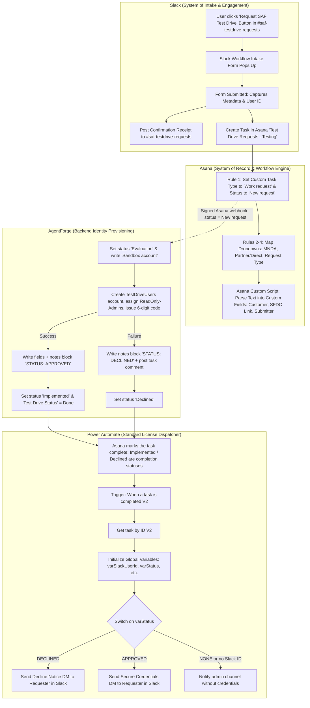
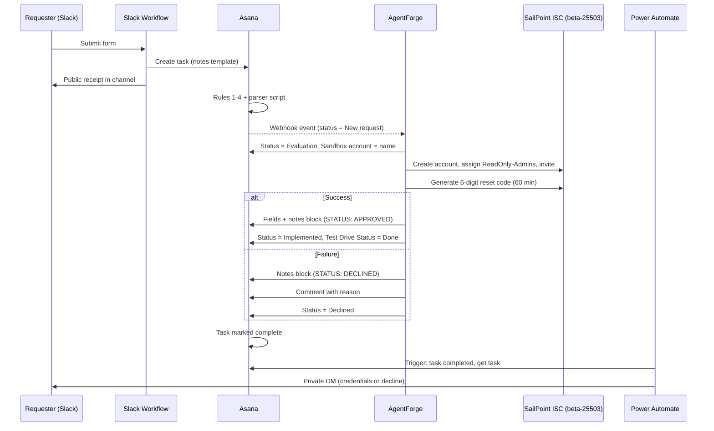

# SAF Test Drive Requests: Technical Architecture & System Specification

| | |
| :--- | :--- |
| **Document version** | 1.1 |
| **Fulfillment notes contract** | v1 (with end marker) |
| **Test project** | `Test Drive Requests - Testing` |
| **Target production project** | `Test Drive Requests` |
| **SailPoint tenant** | `beta-25503` (`https://beta-25503.identitynow-demo.com`) |

## 1. Executive Summary & Objective

The **SAF Test Drive Requests** automation pipeline is a cross-platform enterprise integration connecting **Slack**, **Asana**, **AgentForge (Backend Provisioning)**, and **Microsoft Power Automate**. 

Its primary business objective is to streamline the intake, governance, provisioning, and delivery of temporary, read-only demo environments (tenants) for SailPoint's Secure Agent Framework (SAF) / Entro product lines for Go-To-Market (GTM) teams, Solutions Engineering, and Partners.

### Core Architectural Guarantees
* **Private Slack Delivery:** Sensitive credentials (sandbox account, initial code, tenant link) are never posted to public or shared Slack channels; they are dispatched strictly via private 1-on-1 Slack Direct Messages (DMs). They are, however, stored in the Asana task (see [Section 8](#8-enterprise-security-governance--policy-workarounds)).
* **Short-Lived Credential:** The initial credential is a one-time 6-digit reset code that expires 60 minutes after it is issued, not a reusable password.
* **Notes Before Completion:** AgentForge always writes the fulfillment block to the task notes *before* it changes the task status. Power Automate therefore never sees a completed task without its block.
* **One Block Per Task:** A task holds at most one fulfillment block. A retry or a failure replaces the existing block instead of adding a second one.
* **Standard Licensing Compliance:** Operates completely on Microsoft Power Automate Standard connectors (Office 365 / Slack Standard), requiring zero Premium licenses, custom HTTP webhooks, or third-party middleware (e.g., Zapier/Workato).
* **Zero Custom Slack App / Bot Overhead:** Leverages pre-approved enterprise connectors and native Slack Workflow Builder features, avoiding unapproved custom `xoxb-` bot token dependencies.
* **Resilient Data Contracts:** Each fulfillment value sits on its own line between a start and an end marker, so parsing does not depend on what else is in the notes.

---

## 2. End-to-End System Architecture



> **Important:** AgentForge does **not** set `completed: true` itself. Asana marks the task complete because `Implemented` and `Declined` are configured as completion statuses on the `Work request` task type. If that setting is missing, the Power Automate trigger never fires. This is item 2 of the [cutover checklist](#12-production-cutover--go-live-checklist).

### 2.1 Task Status Lifecycle

| Asana `Work request` status | Set by | What is written | Notes block | Slack message |
| :--- | :--- | :--- | :--- | :--- |
| `New request` | Asana Rule 1 | Task type, dropdown fields, parsed text fields | — | Public receipt in `#saf-testdrive-requests` |
| `Evaluation` | AgentForge | `Sandbox account` (written immediately so a run can resume) | — | — |
| `Implemented` (+ `Test Drive Status` = `Done`) | AgentForge | `Sandbox account`, `Initial password`, tenant link field | `STATUS: APPROVED` | Credentials DM |
| `Declined` | AgentForge | Task comment with the reason | `STATUS: DECLINED` | Decline DM |
| `Needs information` / `Approved` | People only | — | — | — |

`STATUS: APPROVED` in the notes corresponds to the Asana status **Implemented**. AgentForge never sets the Asana status **Approved**.

### 2.2 Sequence



---

## 3. Component Breakdown & Responsibilities

| Component | Role | Trigger / Method | Key Artifacts / IDs | Owner |
| :--- | :--- | :--- | :--- | :--- |
| **Slack Intake Workflow** | Entry point, intake validation, public receipt | Link / Shortcut trigger (`https://slack.com/shortcuts/...`) | Channel `#saf-testdrive-requests` (`C0CFXQTLT6Y`), Workflow Icon: Cyber Shield | _TBD_ |
| **Asana Project Board** | Central system of record, operational tracking | Native Asana Rules & Scripting | Project: `Test Drive Requests - Testing` (Target Prod: `Test Drive Requests`) | _TBD_ |
| **Asana Automation Rules** | Structural state setup & dropdown mapping | `Task added to project` | Custom Task Type: `Work request`, Status: `New request` | _TBD_ |
| **Asana Script (`run()`)** | Dynamic regex metadata parser | `Task added to project` | node-asana v3 SDK parameter sequence | _TBD_ |
| **AgentForge** | Sandbox account provisioning on the SailPoint tenant | Signed Asana project webhook on status `New request` (page poll as fallback) | Writes fields and the `--- FULFILLMENT DETAILS ---` block, then sets `Implemented` or `Declined` | _TBD_ |
| **Power Automate Flow** | Event router & private DM dispatcher | `When a task is completed (V2)` | Flow: `SAF - Fulfillment Thread Reply & DM` | _TBD_ |

---

## 4. Slack Workflow Builder Configuration

* **Workflow Name:** `SAF Test Drive Requests`
* **Trigger:** **Starts from a link in Slack** (`https://slack.com/shortcuts/Ft0CFCS1JXHV/61952`)
* **Trigger Placement:** Pinned inside `#saf-testdrive-requests` (`C0CFXQTLT6Y`) on the **Channel Canvas** and the **Bookmark Bar** as an action button: `🟢 Request SAF Test Drive`.

### Step 1: Collect info in a form
* **Title:** `SAF Test Drive Request`
* **Target:** `Person who clicked the link`
* **Form Fields:**
  1. `Customer` (Short Text, Required) — Full company name as listed in SFDC.
  2. `Customer Email Address(es)` (Short Text, Required) — Comma-separated admin emails (Max 3).
  3. `Link to SFDC Opportunity` (Short Text, Required) — SFDC Opportunity URL.
  4. `Is this Test Drive for a customer directly or through a partner?` (Dropdown: `Customer`, `Partner`)
  5. `Has a SailPoint MNDA or Eval Agreement been signed?` (Dropdown: `Yes`, `No`)
  6. `Is this a net-new provisioning request, or an extension request for an existing Test Drive?` (Dropdown: `New request`, `Extension`)

### Step 2: Create a task (Asana Integration)
* **Workspace:** `SailPoint Technologies`
* **Project:** `Test Drive Requests - Testing` (Move to production upon cutover)
* **Task Name:** `SAF Test Drive Request - {Answer to: Customer}`
* **Description Template (`notes`):**
```text
A new SAF Test Drive Request has been submitted!

Requester: {Person who used this workflow}
Prospect/Customer: {Answer to: Customer}
Main Contact Email(s): {Answer to: Customer Email Address(es)}
SFDC Opportunity Link: {Answer to: Link to SFDC Opportunity}
Test Drive Type: {Answer to: Is this Test Drive for a customer directly or through a partner?}
MNDA Signed?: {Answer to: Has a SailPoint MNDA or Eval Agreement been signed?}
Request Type: {Answer to: Is this a net-new provisioning request, or an extension request for an existing Test Drive?}

Slack User ID: {Person who used this workflow (User ID)}

This task was submitted through SailPoint SAF Test Drive Request.
```

### Step 3: Send a message to a channel
* **Channel:** `#saf-testdrive-requests` (`C0CFXQTLT6Y`)
* **Message Text:**
```text
🎉 *SAF Test Drive Request Submitted!*
Thank you <@{Person who used this workflow}>. Your request has been logged in Asana and provisioning has started.

🔒 *Next Steps:* Once your test drive environment is ready, your credentials, account, and tenant link will be sent directly to your *Direct Messages (DMs)* for security.

*Request Details:*
• *Customer:* {Answer to: Customer}
• *MNDA Signed?:* {Answer to: Has a SailPoint MNDA or Eval Agreement been signed?}
• *Type:* {Answer to: Is this a net-new provisioning request, or an extension request for an existing Test Drive?}
```

---

## 5. Asana Workflow Architecture & Custom Scripting

To convert incoming tasks into the custom `Work request` task type and stamp custom fields without premium middleware, Asana uses a combination of native rules and a custom JavaScript automation.

### Asana Native Visual Rules
* **Rule 1 (`SAF - Initialize Work Request Status`):**
  * *Trigger:* `Task added to this project`
  * *Actions:* `Change task type` ➔ `Work request` THEN `Set Work request status` ➔ `New request`.
* **Rule 2 (`SAF - Map MNDA Signed Status`):**
  * *Trigger:* `Task added to this project`
  * *Branch 1:* Description contains `MNDA Signed?: Yes` ➔ Set `MDNA signed?` = `Yes`
  * *Branch 2:* Description contains `MNDA Signed?: No` ➔ Set `MDNA signed?` = `No`
* **Rule 3 (`SAF - Map Partner or Direct`):**
  * *Trigger:* `Task added to this project`
  * *Branch 1:* Description contains `Test Drive Type: Customer` ➔ Set `Test Drive Partner or Direct` = `Customer`
  * *Branch 2:* Description contains `Test Drive Type: Partner` ➔ Set `Test Drive Partner or Direct` = `Partner`
* **Rule 4 (`SAF - Map New or Extension`):**
  * *Trigger:* `Task added to this project`
  * *Branch 1:* Description contains `Request Type: New request` ➔ Set `New or extension` = `New request`
  * *Branch 2:* Description contains `Request Type: Extension` ➔ Set `New or extension` = `Extension`

### Asana Custom Script: Metadata Parser
* **Rule Name:** `SAF - Parse Slack Metadata & Populate Fields`
* **Trigger:** `Task added to this project`
* **Action:** `Run script`
* **Runtime:** Node.js (node-asana v3 SDK)

```javascript
/**
 * SAF - Parse Slack Metadata & Populate Fields
 * Uses node-asana v3 parameter order: updateTask(body, target_gid)
 */
async function run() {
  if (target_type === "Task") {
    // 1. Retrieve full task details (including notes and custom_fields)
    const task = await tasksApiInstance.getTask(target_gid);
    const description = task.data.notes || "";

    log("Successfully retrieved task notes. Beginning metadata extraction...");

    // 2. Parse values from the description lines
    const requesterRegex = /Request[eo]r:\s*(.+)/i;
    const customerRegex = /Prospect\/Customer:\s*(.+)/i;
    const emailRegex = /Main Contact Email\(s\):\s*(.+)/i;
    const sfdcRegex = /SFDC Opportunity Link:\s*(.+)/i;

    const parsedRequester = (description.match(requesterRegex)?.[1] || "").trim();
    const parsedCustomer = (description.match(customerRegex)?.[1] || "").trim();
    const parsedEmail = (description.match(emailRegex)?.[1] || "").trim();
    const parsedSFDCLink = (description.match(sfdcRegex)?.[1] || "").trim();

    // 3. Dynamically match custom field GIDs by name
    const customFieldsPayload = {};
    const taskCustomFields = task.data.custom_fields || [];

    const findFieldGidByName = (name) => {
      const field = taskCustomFields.find(
        (f) => f.name && f.name.trim().toLowerCase() === name.trim().toLowerCase()
      );
      return field ? field.gid : null;
    };

    const submitterGid = findFieldGidByName("Submitter Name");
    const customerGid = findFieldGidByName("Customer/Partner/Event");
    const emailGid = findFieldGidByName("Main Contact Email");
    const sfdcGid = findFieldGidByName("SFDC Link");

    if (submitterGid && parsedRequester) customFieldsPayload[submitterGid] = parsedRequester;
    if (customerGid && parsedCustomer) customFieldsPayload[customerGid] = parsedCustomer;
    if (emailGid && parsedEmail) customFieldsPayload[emailGid] = parsedEmail;
    if (sfdcGid && parsedSFDCLink) customFieldsPayload[sfdcGid] = parsedSFDCLink;

    // 4. Update the task with payload FIRST, target_gid SECOND (node-asana v3)
    if (Object.keys(customFieldsPayload).length > 0) {
      log("Updating custom fields payload: " + JSON.stringify(customFieldsPayload));

      await tasksApiInstance.updateTask(
        {
          data: {
            custom_fields: customFieldsPayload,
          },
        },
        target_gid
      );

      log("Successfully updated all custom text fields in Asana!");
    } else {
      log("No matching custom fields or parsed values found. Skipping update.");
    }
  }
}

run();
```

---

## 6. AgentForge Provisioning & Fulfillment Contract

### 6.1 Detection
* **Primary:** an Asana webhook on the project. Asana signs every event and AgentForge verifies the signature before acting. The webhook is registered when **Save and connect** is pressed in the AgentForge back desk.
* **Fallback:** while the AgentForge page is open, it polls every 4 seconds to finish accounts that are still activating. The full lookup of tenant accounts runs at most every 5 minutes.
* **Trigger condition:** the task's `Work request` status is `New request`. AgentForge does not read the `MDNA signed?` or `New or extension` fields (see [Section 13](#13-known-gaps--open-items)).

### 6.2 What AgentForge creates in SailPoint

| Item | Value |
| :--- | :--- |
| Tenant | `beta-25503` |
| Source | `TestDriveUsers` (account type `TestDrive`) |
| Username | Random `first.last@testmail.identitysoon.com`. It is not derived from the customer name. |
| Access | Role `ReadOnly-Admins`, granted automatically to `TestDrive` accounts; it grants the `SAF Admin` entitlement on the `IdentityNow` source |
| Lifecycle | Identity set to active, invitation sent |
| Initial credential | 6-digit helpdesk reset code, valid for **60 minutes** (longer durations are tracked in ISCARP-20309) |

### 6.3 Order of writes to Asana
1. Status → `Evaluation`, and the `Sandbox account` field is written straight away. A run that stops part-way can resume from this field instead of creating a second account.
2. **Success:** the `Sandbox account`, `Initial password` and tenant link fields, plus the notes block, are written in **one** update. Only after that does a second update set the status to `Implemented` and `Test Drive Status` to `Done`.
3. **Failure:** the `STATUS: DECLINED` notes block is written, then a task comment with the same reason is posted, then the status is set to `Declined`. A task that is already `Implemented` is never declined.

The tenant link field is configurable in the back desk; the test project currently uses `Customer role`.

### 6.4 Notes contract (v1)

The block is always at the bottom of the notes, starts with `--- FULFILLMENT DETAILS ---`, ends with `--- END FULFILLMENT DETAILS ---`, and holds one `KEY: value` per line. When AgentForge writes a new block it removes any earlier one first. Text that someone adds below an end marker is kept above the new block.

#### Contract Schema A: Provisioning Success (Approved)
```text
--- FULFILLMENT DETAILS ---
STATUS: APPROVED
TENANT_LINK: https://beta-25503.identitynow-demo.com
SANDBOX_ACCOUNT: jade.ortiz@testmail.identitysoon.com
INITIAL_PASSWORD: 008604
--- END FULFILLMENT DETAILS ---
```

#### Contract Schema B: Provisioning Failure (Declined)
```text
--- FULFILLMENT DETAILS ---
STATUS: DECLINED
REASON: SailPoint API returned HTTP 503 for POST /accounts/v1. Tenant unavailable.
--- END FULFILLMENT DETAILS ---
```

`REASON` is always a single line. Blocks written before the end marker was introduced have no end marker and run to the end of the notes; AgentForge still replaces them correctly.

**Contract rules:** keys, their order, and the uppercase `STATUS` values are a contract with the Power Automate flow. Any change must bump the contract version at the top of this document and be released together with the flow update.

### 6.5 Back desk configuration
The back desk (AgentForge → Read-only account panel) holds the settings AgentForge needs. They are stored in DynamoDB, so they survive deploys and are shared by every server.

| Setting | Purpose |
| :--- | :--- |
| Asana access token | Reads and updates tasks, registers the webhook |
| SailPoint tenant, client ID, client secret | Calls the tenant APIs |
| Project name | `Test Drive Requests - Testing` → production `Test Drive Requests` |
| Statuses | Trigger `New request`, working `Evaluation`, done `Implemented`, declined `Declined` |
| Fields | `Sandbox account`, `Initial password`, tenant link field |
| Tenant link template | `https://{tenant}.identitynow-demo.com` |

Hosting requirements (Amplify):
* `SAF_POC_TABLE_NAME` is set, and the compute role (`AMPLIFY_COMPUTE_ROLE_NAME`) can read and write that table.
* Without the table, **Save and connect** refuses to save on a deployed server, because a file on the server is erased on every deploy.
* The panel shows where the desk is stored after each save. If the desk cannot be read, AgentForge leaves tasks untouched instead of declining them.

---

## 7. Power Automate Workflow Specification

* **Flow Name:** `SAF - Fulfillment Thread Reply & DM`
* **Trigger:** `Asana - When a task is completed (V2)`
  * *Workspace:* `SailPoint Technologies`
  * *Project:* `Test Drive Requests - Testing`
* **Action 1:** `Asana - Get task by ID (V2)`
  * *Task ID:* `@{triggerOutputs()?['body/gid']}`
* **Parse the plain `notes` field directly.** Asana's `notes` is already plain text (`html_notes` is the HTML version). The previous `Html to text` step is not needed and can change line breaks, which the expressions below rely on. If the step is kept, test that line breaks survive it.

### Root-Level Variable Declarations (Sequential Stack)

> **Platform Rule:** In Power Automate, all `Initialize variable` actions MUST be declared at the root level of the flow. They cannot be nested inside Conditions.

`decodeUriComponent('%0A')` is a line break. Every value is read up to the end of its own line, so nothing after it can leak into a DM.

1. **`varNotes`** (Type: `String`)
   ```text
   @{coalesce(outputs('Get_task_by_ID_(V2)')?['body/notes'], '')}
   ```
2. **`varBlock`** (Type: `String`) — only the text between the two markers
   ```text
   if(and(contains(variables('varNotes'), '--- FULFILLMENT DETAILS ---'), contains(variables('varNotes'), '--- END FULFILLMENT DETAILS ---')), first(split(last(split(variables('varNotes'), '--- FULFILLMENT DETAILS ---')), '--- END FULFILLMENT DETAILS ---')), '')
   ```
3. **`varSlackUserId`** (Type: `String`) — empty when missing; there is **no** default user
   ```text
   if(contains(variables('varNotes'), 'Slack User ID: '), trim(first(split(first(split(last(split(variables('varNotes'), 'Slack User ID: ')), decodeUriComponent('%0A'))), ' '))), '')
   ```
4. **`varStatus`** (Type: `String`) — `APPROVED`, `DECLINED`, or `NONE`
   ```text
   if(contains(variables('varBlock'), 'STATUS: DECLINED'), 'DECLINED', if(contains(variables('varBlock'), 'STATUS: APPROVED'), 'APPROVED', 'NONE'))
   ```
5. **`varDeclineReason`** (Type: `String`)
   ```text
   if(contains(variables('varBlock'), 'REASON:'), trim(first(split(last(split(variables('varBlock'), 'REASON:')), decodeUriComponent('%0A')))), 'No specific reason provided.')
   ```
6. **`varTenantLink`** (Type: `String`)
   ```text
   if(contains(variables('varBlock'), 'TENANT_LINK:'), trim(first(split(last(split(variables('varBlock'), 'TENANT_LINK:')), decodeUriComponent('%0A')))), '')
   ```
7. **`varSandboxAccount`** (Type: `String`)
   ```text
   if(contains(variables('varBlock'), 'SANDBOX_ACCOUNT:'), trim(first(split(last(split(variables('varBlock'), 'SANDBOX_ACCOUNT:')), decodeUriComponent('%0A')))), '')
   ```
8. **`varInitialPassword`** (Type: `String`)
   ```text
   if(contains(variables('varBlock'), 'INITIAL_PASSWORD:'), trim(first(split(last(split(variables('varBlock'), 'INITIAL_PASSWORD:')), decodeUriComponent('%0A')))), '')
   ```

### Condition & Branching Logic

1. **Condition `CanRoute`:** `varSlackUserId` is not empty **and** `varStatus` is not `NONE` **and**, when `varStatus` is `APPROVED`, `varSandboxAccount` and `varInitialPassword` are not empty.
   * **False → Admin notice.** `Slack - Post message (V2)` to the private admin channel (_TBD_), with **no credentials**:
     ```text
     ⚠️ SAF Test Drive task completed but could not be routed.
     Task: https://app.asana.com/0/0/@{triggerOutputs()?['body/gid']}
     Status block: @{variables('varStatus')} | Slack User ID: @{variables('varSlackUserId')}
     ```
     This covers tasks completed by hand, tasks declined by a person without a block, and requests without a Slack User ID.
   * **True → Switch on `varStatus`** (below).

#### Case `DECLINED`
* **Action:** `Slack - Post message (V2)`
  * *Channel Name (Enter custom value):* `@{variables('varSlackUserId')}` *(Routes natively as a private DM)*
  * *Message Text:*
```text
⚠️ *SAF Test Drive Request Update*

Hi <@{variables('varSlackUserId')}>,

Your SAF Test Drive request could not be completed at this time.

• *Status:* ❌ *DECLINED*
• *Reason:* @{variables('varDeclineReason')}

👉 *Next Steps:* Please follow up with the team in *#saf-testdrive-requests* if you need assistance or believe this was declined in error.
```

#### Case `APPROVED`
* **Action:** `Slack - Post message (V2)`
  * *Channel Name (Enter custom value):* `@{variables('varSlackUserId')}`
  * *Message Text:*
```text
🎉 *Your SAF Test Drive Environment is Ready!*

Hi <@{variables('varSlackUserId')}>,

Your SAF Test Drive environment has been provisioned. Here are your details:

🔗 *Tenant Link:* @{variables('varTenantLink')}
👤 *Sandbox Account:* `@{variables('varSandboxAccount')}`
🔑 *One-time code:* `@{variables('varInitialPassword')}`

⏱️ This 6-digit code expires *60 minutes* after it was issued. Use it to set your own password the first time you sign in. If it has expired, ask in *#saf-testdrive-requests* for a new one.

🔒 *Security Notice:* Do not share these details in public channels.
```

> **Duplicate messages:** if a task is reopened and completed again, the trigger fires again and the requester receives a second DM. That is expected after a retry (see [Section 10](#10-runbook--observability)).

---

## 8. Enterprise Security, Governance, & Policy Workarounds

| Enterprise Constraint | Technical Impact | Architectural Solution / Workaround |
| :--- | :--- | :--- |
| **No Slack Bot Tokens (`xoxb-`)** | Direct Asana-to-Slack `fetch()` calls blocked | Power Automate standard Slack connector runs under authorized corporate user context. DMs therefore come from that named user. |
| **No Slack Channel Read / History in Power Automate** | Power Automate cannot read channels or resolve thread timestamps | Eliminated thread dependency. Form captures raw `Slack User ID`, and Power Automate DMs the user directly. |
| **Slack DM Action Blocked in Power Automate** | Standard `Post DM` step unavailable | Trick: Pass raw `Slack User ID` (e.g., `U0AUACHKTDF`) into the `Channel Name` parameter of `Post message (V2)`. |
| **No Premium Microsoft Licenses** | Custom HTTP Webhook triggers and actions locked | Replaced webhook trigger with native `When a task is completed (V2)` trigger on Asana. |
| **Missing Custom Fields in Asana API** | `Get task by ID (V2)` omits custom fields by default | Description notes (`notes`) hold the fulfillment payload. Power Automate parses notes directly using regex-free string splits between start and end markers. |
| **Variable Initialization Nesting Error** | Flow save fails if variables are placed inside Condition | All 8 variables are initialized at the top level with `if(contains(...))` fallback safety checks. |

### 8.1 Where credentials live

| Location | Contents | Who can see it |
| :--- | :--- | :--- |
| Asana task notes | Account, one-time code, tenant link | Every project member, plus the task's change history |
| Asana fields `Sandbox account` / `Initial password` | Account, one-time code | Every project member |
| Slack DM | Account, one-time code, tenant link | The requester only |
| AgentForge back desk (DynamoDB) | Asana token, SailPoint client secret | AWS account administrators |

Mitigations:
* The code is single-use and expires after 60 minutes, which limits the exposure in Asana.
* Keep the Asana project private to the fulfillment team.
* _Optional:_ after the DM is sent, have the flow clear `INITIAL_PASSWORD` from the notes with `Asana - Update task`.
* The Power Automate fallback never sends credentials to anyone but the parsed requester. There is no hard-coded default user.

---

## 9. Failure Catalog

Every failure produces a `STATUS: DECLINED` block, a task comment with the same reason, the status `Declined`, and a decline DM, unless noted.

| Failure | What the reason says | Likely cause | Action |
| :--- | :--- | :--- | :--- |
| SailPoint unavailable | `SailPoint API returned HTTP 503 for <request>…` | Tenant down or in maintenance | Wait, then retry (Section 10) |
| Cloudflare block | `Cloudflare blocked the request (error <code>, Ray ID <id>). This is a network block in front of the tenant…` | WAF rule in front of the tenant | Send the error code and Ray ID to the tenant/network owners |
| Reset code refused | `Reset code was not issued. SailPoint API returned HTTP 403 for POST /v2025/generate-password-reset-token/digit…` | Digit token reset disabled, or client lacks scope | Fix tenant config or client scopes, then retry |
| Account never activates | Status stays `Evaluation` | Tenant aggregation is slow | AgentForge keeps checking; investigate if it stays longer than the agreed limit (_TBD_) |
| Back desk missing or unreadable | **Task is left unchanged** (not declined) | Desk not saved after a deploy, or DynamoDB unreachable | Open the back desk, **Save and connect** |
| Asana update fails | Reason names the Asana call and HTTP status | Expired token, field renamed, missing permission | Fix the token or field names in the back desk |
| No Slack User ID / no block | No DM; admin notice instead | Form changed, or task completed by hand | Contact the requester directly |

---

## 10. Runbook & Observability

### Where to look
* **Asana task:** the status, the comments (failure reasons), the notes block, and the activity history.
* **AgentForge:** the webhook log in the read-only account panel shows every event received and what was done with it. The panel also shows where the back desk is stored.
* **Power Automate:** the run history of `SAF - Fulfillment Thread Reply & DM` shows each variable's parsed value.

### Retry a declined request
1. Fix the cause listed in the reason.
2. Reopen the task (mark it incomplete), then set the `Work request` status back to `New request`.
3. AgentForge creates a **new** sandbox account and replaces the notes block; the requester receives a new DM. The account from the earlier attempt, if any, stays in the tenant and must be removed by hand.

### Re-issue an expired code
_TBD:_ AgentForge has no separate "new code" action today. The current workaround is the retry above, which also creates a new account.

---

## 11. E2E Test Plan

Run these in `Test Drive Requests - Testing` before cutover and after any change to the form, rules, AgentForge, or the flow.

| # | Scenario | Setup | Expected in Asana | Expected in Slack |
| :--- | :--- | :--- | :--- | :--- |
| 1 | Happy path | Valid form | `Evaluation` → `Implemented`, `Test Drive Status` = `Done`, fields filled, `STATUS: APPROVED` block, task complete | Receipt in channel + credentials DM; code works within 60 minutes |
| 2 | SailPoint down | Tenant unavailable | `STATUS: DECLINED` with an HTTP 5xx reason, comment, `Declined` | Decline DM with the same reason |
| 3 | Cloudflare block | Request blocked at the edge | Reason includes error code and Ray ID | Decline DM |
| 4 | Back desk missing | Deploy without saving the desk | Task stays `New request`, nothing written | No DM |
| 5 | Retry after decline | Scenario 2, then follow the retry steps | Exactly one block in the notes, `STATUS: APPROVED` | Second DM with credentials |
| 6 | Manual completion | Mark a `New request` task complete by hand | No block | Admin notice, no DM to the requester |
| 7 | Missing Slack User ID | Remove the line from the notes before completion | — | Admin notice, no credentials sent |
| 8 | Text after the block | Add a line below the end marker, then retry | New block at the bottom, the added line kept above it | DM values unaffected |
| 9 | Duplicate submission | Submit the same customer twice | Two tasks, two accounts | Two DMs |
| 10 | MNDA = No | Form with MNDA `No` | _Currently provisions anyway_ (see Section 13) | Credentials DM |
| 11 | Extension | Form with request type `Extension` | _Currently creates a new account_ (see Section 13) | Credentials DM |
| 12 | Line breaks in the flow | Any approved task | — | Run history shows each variable on one line with no trailing text |

---

## 12. Production Cutover & Go-Live Checklist

Follow these steps when moving from the sandbox environment to live production:

1. **Slack Workflow Builder:**
   * Open `SAF Test Drive Requests`.
   * Edit **Step 2 (Create a task):** Change project from `Test Drive Requests - Testing` to production project: `Test Drive Requests`.
   * Confirm the trigger link is shared in `#saf-testdrive-requests` via the Canvas button and Bookmark Bar.
2. **Production Asana Board Setup:**
   * Ensure the project has the custom task type `Work request` enabled with statuses: `New request`, `Needs information`, `Evaluation`, `Approved`, `Declined`, `Implemented`.
   * **Confirm that `Implemented` and `Declined` mark the task complete.** Without this, Power Automate never fires.
   * Create/verify custom fields: `Submitter Name`, `Customer/Partner/Event`, `Main Contact Email`, `SFDC Link`, `MDNA signed?`, `Test Drive Partner or Direct`, `New or extension`, `Sandbox account`, `Initial password`, `Test Drive Status` (with option `Done`), and the tenant link field (`Customer role` today, or a new `Tenant Link` field).
   * Replicate the **4 Native Rules** and the **Custom Script (`SAF - Parse Slack Metadata & Populate Fields`)**.
   * Keep the project private to the fulfillment team (Section 8.1).
3. **AgentForge Backend:**
   * Confirm `SAF_POC_TABLE_NAME` is set in Amplify and the compute role can use the table.
   * In the back desk, set the project name to `Test Drive Requests`, check the status and field names, and press **Save and connect**. The panel must report DynamoDB storage.
   * Confirm the webhook log shows events from the production project.
   * Verify the block is written with proper casing (`STATUS: APPROVED` or `STATUS: DECLINED`) and ends with `--- END FULFILLMENT DETAILS ---`.
4. **Power Automate Production Flow:**
   * In `SAF - Fulfillment Thread Reply & DM`, update the **Trigger** and **Get task by ID** steps to point to the production Asana workspace and project.
   * Update the variables to the expressions in Section 7 and set the admin notice channel.
   * Verify flow status is toggled to **On / Active**.
5. **Sign-off:** run E2E scenarios 1, 2, 5, 6 and 12 against production.

---

## 13. Known Gaps & Open Items

| Item | Impact | Proposal | Owner |
| :--- | :--- | :--- | :--- |
| MNDA is not enforced | Requests with MNDA `No` are provisioned | Asana rule: MNDA `No` → status `Needs information` (AgentForge only acts on `New request`), or have AgentForge decline it | _TBD_ |
| Extensions create new accounts | An extension request produces a second account instead of extending the first | Route `Extension` to `Needs information` until extension handling exists | _TBD_ |
| No account expiry | Sandbox accounts stay until removed by hand | Define a lifetime and a cleanup job | _TBD_ |
| No code re-issue | An expired code needs a full retry and a new account | Add a "new code" action in AgentForge | _TBD_ |
| Customer emails unused | `Main Contact Email` is captured but not used | Confirm whether customers should get accounts directly | _TBD_ |
| Tenant link stored in `Customer role` | Field name does not match its content | Create a `Tenant Link` field and update the back desk | _TBD_ |
| `MDNA signed?` field name | Typo in the Asana field name | Rename to `MNDA signed?` and update Rule 2 | _TBD_ |
| Code sign-in steps | The DM wording assumes the code is used to set a password on first sign-in | Confirm the steps with the identity team and update the DM | _TBD_ |
| Admin notice channel | Section 7 needs a private channel | Choose the channel | _TBD_ |
