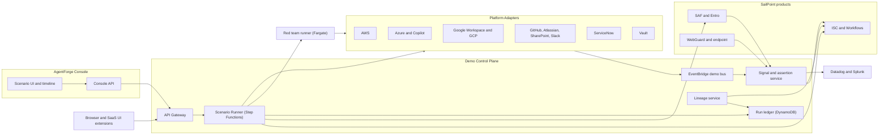

# SAF Demo Platform: Architecture & Technical Specification

| Field | Value |
| :--- | :--- |
| **Status** | Draft for review |
| **Version** | 0.1 |
| **Scope** | The 25 demo use cases (UC-01 to UC-25) in `saf_meeting_use_cases.xlsx`, grouped into the 21 features on its `Features to build` sheet |
| **Builds on** | AgentForge (Next.js on AWS Amplify), SailPoint ISC, SailPoint Agentic Fabric (SAF) and Entro, WebGuard |
| **Execution mode** | Live: actions run against real AWS, Azure, Google, SaaS, Entro/SAF, and ISC. A simulator is used only where a platform has no API. |

## 1. Purpose

SEs need to show SAF working on real agents, real credentials, and real cloud accounts. They need to show it live, repeatably, and without leaving anything behind after the demo. This document describes the platform that makes that possible:

* **What is built.** AgentForge stays the console. A new demo control plane runs scenarios, and platform adapters act on each cloud and SaaS system.
* **What is integrated, not rebuilt.** Detection by Entro and NHIDR, prompt protection by WebGuard, endpoint enforcement, the ServiceNow AI Control Tower, and the SailPoint SaaS UI.
* **How it stays safe.** Every action is scoped, recorded, and reversible.

### 1.1 Goals

1. **Live and truthful.** Every use case runs against the real system. When a demo shows a finding, the product raised it. Activity dates, risk scores, and detections are never faked.
2. **Repeatable.** Any scenario can be run, reset, and run again, with the same result.
3. **Safe by construction.** Scenarios can only touch resources that are tagged and allowlisted. Every change has a recorded undo action. Destructive steps require confirmation.
4. **Observable.** A presenter can see each step, its assertion, and the time taken. An engineer can follow one run ID from the console, through every adapter, into ISC and Datadog.
5. **Maintainable.** One adapter interface per platform, one declarative scenario format, and one infrastructure-as-code application.

### 1.2 Non-goals

* Rebuilding product capabilities: secret detection, NHIDR anomaly detection, prompt redaction, endpoint blocking, or registry correlation. AgentForge triggers them and checks that they fired.
* Production identity governance for customers. This platform runs demos, proofs of concept, and rehearsals in SailPoint-owned or customer demo environments.
* A general-purpose attack framework. The red team runner executes a fixed, reviewed set of playbooks in allowlisted accounts.

### 1.3 Terms

| Term | Meaning |
| :--- | :--- |
| **Scenario** | A versioned, declarative definition of one demo: preconditions, steps, assertions, and undo actions. |
| **Run** | One execution of a scenario, with a unique `runId`. |
| **Step** | One action in a run, performed by an adapter or a SailPoint product API. |
| **Assertion** | A check that a product reacted, for example "ISC shows the agent with an owner within 120 seconds". |
| **Undo action** | The recorded inverse of a step, used by reset. Also called a compensation. |
| **Adapter** | The component that performs actions on one external platform. |
| **Demo environment** | A set of cloud accounts, SaaS tenants, and one ISC tenant that scenarios may act on. |
| **Canary credential** | A real credential with no permissions and a short lifetime, planted so the product can find it. |

---

## 2. Current State

AgentForge is a single Next.js application deployed on AWS Amplify. The pieces this platform reuses already exist.

| Capability | Location | Reused for |
| :--- | :--- | :--- |
| ISC client: OAuth and PAT auth, sources, aggregations, machine-account mappings, revoke, workflows, machine identities, search | `src/lib/isc/*`, `src/lib/saf-poc/sailpoint.ts` | All ISC steps and assertions |
| SSF transmitter emitting signed CAEP and verification events | `src/lib/saf-poc/transmitter.ts`, `src/app/ssf/*`, `src/app/.well-known/*` | Signal forwarding to ISC |
| SAF event ingestion and Datadog log intake | `src/lib/saf-poc/events.ts`, `src/app/webhooks/saf` | SIEM deep link (UC-16), assertions |
| Datadog security rule management | `src/lib/saf-poc/datadog-security.ts` | UC-16 |
| AWS environment runner on CodeBuild (deploys the FinBot agent, runs the SAF config loader) | `src/lib/environments/*`, `infra/agentforge-environment-runner.yaml` | Agent deployment (UC-01) |
| ISC Web Services connector endpoints for Bedrock, Vertex, and Foundry | `src/app/api/connectors/web-services/*` | Registry merge (UC-06), access shaping (UC-08) |
| Synthetic agents, bulk generator, and the sync/govern demo | `src/lib/agents/*`, `src/lib/demo/*` | Vertical profiles (UC-12), current reset |
| Ask-tenant read-only tools and MCP server | `src/lib/ask-tenant/*` | Narration of runs |

### 2.1 Findings that block the new work

These must be fixed before the control plane goes live, because the new features would rely on them.

1. **Authentication bypass in the middleware.** In `src/middleware.ts`, `isPublic` returns true for any path that contains a dot:

   ```typescript
   pathname.includes(".") ||
   ```

   It was meant to let static files through, but it also skips the sign-in check for any API route whose path contains a dot, for example an ID such as `agent.v2`. The matcher already excludes `_next/static` and `_next/image`. Files served from `public/` still pass through the middleware, so the check should allow only known file extensions, and never paths under `/api/`.
2. **Connector routes need machine authentication.** ISC's Web Services connector calls `/api/connectors/web-services/*`. Those routes are not on the public list, so they require a browser session cookie. They need service authentication: an API key or OAuth client credentials, checked per source.
3. **State is kept in files on each server.** Agents (`src/lib/db/store.ts`) and ISC settings (`src/lib/isc/settings-store.ts`) are JSON files in the data folder, or `/tmp` on AWS. Each Amplify server has its own copy, and the copy is erased on every deploy. This is the same failure the Asana back desk had before it moved to DynamoDB. Scenario state cannot live there.
4. **Secrets are stored in plaintext.** The back desk keeps the Asana token and the SailPoint client secret in DynamoDB without application-level encryption. New adapters will hold many more credentials.
5. **There is no durable job runtime.** Long work runs either in CodeBuild or inside a web request. The only scheduler is one EventBridge rule that fires every minute. Scenarios need waits of seconds to minutes, retries, and undo, which a web request on Amplify cannot hold.
6. **One shared admin login.** There is no per-user identity, so there is no audit trail of who ran a destructive step.
7. **Logging is unstructured.** Logging is ad-hoc `console.*` calls with no correlation ID. A failure cannot be traced across systems.

---

## 3. Target Architecture

### 3.1 Overview



### 3.2 Components at a glance

| Component | Status | Runs on | Responsibility |
| :--- | :--- | :--- | :--- |
| **AgentForge Console** | Existing, extended | Amplify (Next.js) | Scenario catalog, run timeline, confirmations, environment setup. No long-running work. |
| **Demo control plane** | New | API Gateway, Lambda, Step Functions, EventBridge, DynamoDB | Runs scenarios, records every step and its undo action, enforces the safety boundary. |
| **Platform adapters** | New | One Lambda per platform | Act on one external system through a common interface. |
| **Signal and assertion service** | New | Lambda on EventBridge | Collects product signals, resolves assertions, forwards signals to ISC and the SIEM. |
| **Lineage service** | New | OpenTelemetry collector, Lambda | Records agent-to-agent calls and publishes the relationships. |
| **Red team runner** | New | ECS Fargate tasks | Runs reviewed attack playbooks in allowlisted accounts. |
| **Entro inspector** | New | Browser extension (Manifest V3) | Read-only view of the Entro objects behind SAF for SEs. |
| **SaaS navigation widget** | New | SailPoint SaaS UI extension | Shows agent risk metrics inside SailPoint. |
| **SailPoint products** | External | SaaS | ISC, Workflows, SAF, Entro, NHIDR, WebGuard. Integrated, not rebuilt. |

### 3.3 Request path for a run

1. A presenter picks a scenario and an environment in the console. The console checks the presenter's role and shows the steps that need confirmation.
2. The console calls `POST /runs` on the control plane with an idempotency key. The control plane validates the scenario, the environment allowlist, and the tags, then starts a Step Functions execution.
3. Each step runs in an adapter Lambda. Before the step returns, its result and its undo action are written to the ledger in the same transaction.
4. Assertion steps wait on a Step Functions task token. The signal service resumes them when the expected signal arrives, or the step times out.
5. The console subscribes to run events, by polling now and by WebSocket later, and draws the timeline.
6. Reset replays the run's undo actions in reverse order.

The console never calls a cloud or SaaS API directly. Every change to an external system goes through the control plane, so every change is recorded and can be undone.

---

## 4. Component Specifications

### 4.1 Demo control plane

**Responsibility.** Accept run requests, enforce the safety boundary, run scenarios to completion or failure, record every step, and undo runs.

**Runtime.**
* API Gateway (HTTP API).
* Lambda functions for the run API, the scenario compiler, and step dispatch.
* Step Functions Standard workflows for runs. Standard is required because runs can last longer than 5 minutes and need an exactly-once history.
* An EventBridge bus named `agentforge-demo`.
* A DynamoDB single table named `agentforge-demo`, described in Section 6.4.
* An SQS dead-letter queue for each asynchronous consumer.

**API (version 1).**

| Method and path | Purpose | Role |
| :--- | :--- | :--- |
| `GET /scenarios` | List published scenarios and their versions | Presenter |
| `POST /runs` | Start a run. Body: `scenarioId`, `version`, `environmentId`, `parameters`, `dryRun`. Header: `Idempotency-Key`. | Presenter |
| `GET /runs/{runId}` | Run status, steps, assertions, timings | Presenter |
| `GET /runs/{runId}/events` | Event stream for the timeline | Presenter |
| `POST /runs/{runId}/confirm/{stepId}` | Approve a step that requires confirmation | Presenter |
| `POST /runs/{runId}/cancel` | Stop the run, keeping completed steps | Presenter |
| `POST /runs/{runId}/reset` | Undo every completed step, in reverse order | Presenter |
| `POST /environments/{id}/reset` | Undo every open run in an environment | Builder |
| `POST /kill-switch` | Stop all runs, globally or for one environment | Admin |
| `POST /actions/{token}` | One-click remediation from a message (UC-11). The token is single-use and signed. | Token only |
| `GET /metrics/agents` | Read-only risk metrics for the SaaS widget (UC-25) | ISC OAuth |

**Run states.** `PENDING`, `VALIDATING`, `RUNNING`, `WAITING_CONFIRMATION`, `WAITING_SIGNAL`, `SUCCEEDED`, `FAILED`, `CANCELLED`, `RESETTING`, `RESET`, `RESET_FAILED`.

**Behaviour.**
* A run starts only if the environment is allowlisted, the kill switch is off, and no other run holds the environment lock. The lock is a conditional write on `ENV#{id}` with a lease, so a crashed run cannot hold it forever.
* Every step writes its result and its undo action in one `TransactWriteItems` call. If the external call succeeded but the write failed, the step is retried and the adapter detects the duplicate by its idempotency key.
* A failed run is not undone automatically. The presenter chooses between reset and resume, because a partial state is sometimes what they want to show.

### 4.2 Scenario model

Each use case is a YAML file in `scenarios/` that is reviewed like code. The compiler checks it against a JSON Schema and turns it into a Step Functions definition.

```yaml
id: uc-07-owner-succession
version: 3
title: Live succession management
pillar: govern
requires:
  adapters: [aws]
  sailpoint: [isc.workflows, isc.machineIdentities]
parameters:
  slaSeconds: { type: integer, default: 60 }
preconditions:
  - isc.machineIdentity.exists: { ref: hero-agent }
  - isc.identity.lifecycle: { ref: demo-owner, state: active }
steps:
  - id: terminate-owner
    action: isc.identity.setLifecycleState
    with: { ref: demo-owner, state: terminated }
    confirm: true
    undo: isc.identity.setLifecycleState { ref: demo-owner, state: active }
  - id: owner-reassigned
    assert: isc.machineIdentity.ownerChanged
    with: { ref: hero-agent, from: demo-owner }
    timeoutSeconds: "{{ parameters.slaSeconds }}"
    showElapsed: true
```

Rules:
* Every step that changes something must declare `undo`, or `undo: none` with a reason. The compiler rejects any other step.
* Assertions only read state. They never change it.
* A `ref` names an object in the environment inventory, never a hard-coded ID, so the same scenario runs in any environment.
* A scenario version is immutable once published. A run records the version it used.

### 4.3 Platform adapter interface

Every adapter implements the same contract. Adapters are thin: they translate the contract to one platform's API and nothing more.

```typescript
interface PlatformAdapter {
  readonly platform: PlatformId;
  capabilities(): AdapterCapability[];

  discover(env: EnvRef): Promise<DiscoveredAgent[]>;
  describeTopology(env: EnvRef, agent: AgentRef): Promise<AgentTopology>;
  listCredentials(env: EnvRef, agent: AgentRef): Promise<CredentialRef[]>;
  lastActivity(env: EnvRef, subject: SubjectRef): Promise<ActivityRecord | null>;

  shapeAccess(ctx: StepContext, agent: AgentRef, posture: AccessPosture): Promise<StepResult>;
  disable(ctx: StepContext, target: CredentialRef | AgentRef): Promise<StepResult>;
  enable(ctx: StepContext, target: CredentialRef | AgentRef): Promise<StepResult>;

  seed(ctx: StepContext, spec: SeedSpec): Promise<StepResult>;
  snapshot(ctx: StepContext, target: ResourceRef): Promise<Snapshot>;
  restore(ctx: StepContext, snapshot: Snapshot): Promise<StepResult>;
  cleanup(ctx: StepContext, target: ResourceRef): Promise<StepResult>;
}

interface StepResult {
  status: "applied" | "unchanged" | "skipped";
  undo: UndoAction | null;
  evidence: Record<string, unknown>;
}

type AccessPosture = "active" | "quarantined" | "disabled";
```

Requirements:
* **Idempotent.** Every mutating call takes `ctx.idempotencyKey`. A repeated call returns the first result instead of acting twice.
* **Snapshot before change.** `shapeAccess`, `disable`, and `seed` record the prior state before acting. The undo action restores that snapshot, so it does not depend on defaults.
* **Tag check.** The adapter refuses any resource that does not carry `agentforge:demo=<environmentId>`. It does not rely only on the control plane for this.
* **Least privilege.** Each adapter Lambda has its own role. Cross-account access uses `sts:AssumeRole` with an `ExternalId`, into a role whose policy is limited by the demo tag.
* **Capabilities are declared.** A scenario that needs a capability the adapter does not declare fails validation before it starts.

**Adapters and the APIs they use.**

| Adapter | Main APIs |
| :--- | :--- |
| **AWS** | Bedrock Agents (`GetAgent`, `ListAgentActionGroups`, `ListAgentKnowledgeBases`). AgentCore control (`ListAgentRuntimes`, `ListGateways`, `ListGatewayTargets`). IAM (`PutRolePermissionsBoundary`, `DeleteRolePermissionsBoundary`, `UpdateAccessKey`, `GenerateServiceLastAccessedDetails`, `GetAccessKeyLastUsed`). Secrets Manager. CloudTrail through EventBridge. Deployment through the existing CodeBuild runner. |
| **Azure and Copilot** | Azure AI Foundry Agent Service (agents and their tools). Microsoft Graph (`servicePrincipal.accountEnabled`, sign-in activity). Copilot Studio through the Dataverse `bot` and `botcomponent` tables. |
| **Google Workspace and GCP** | IAM (`serviceAccounts.disable` and `enable`, `serviceAccounts.keys.disable` and `enable`). Admin SDK Directory (`users.update` for the organizational unit, `tokens.delete`). Policy Intelligence activity analysis (`serviceAccountLastAuthentication`). Vertex AI Agent Builder. |
| **GitHub** | Contents API in a dedicated demo organization. Secret scanning push protection stays on; the organization uses a documented bypass policy for canary files only. |
| **Atlassian** | Jira issue and Confluence page REST APIs, in a demo site. |
| **SharePoint** | Microsoft Graph drive upload, in a demo site. |
| **Slack** | Message posting in a demo workspace. Bot tokens are restricted by enterprise policy, so this needs an approved app or a user token (see Section 9). |
| **ServiceNow** | Table API for the AI Control Tower registry. The table name is to be confirmed. |
| **Vault** | HashiCorp Vault KV v2 and its audit device, or AWS Secrets Manager, depending on which vault the demo environment uses. |

### 4.4 Signal and assertion service

**Responsibility.** Decide whether the product reacted, and forward signals to where people will see them.

**Inputs.** All arrive on the `agentforge-demo` bus as normalized `DemoSignal` events:
* SAF and Entro findings, through webhook or polling;
* ISC events from a workflow that posts to the control plane, plus polling of machine identities and search;
* the existing SAF webhook, `src/app/webhooks/saf`;
* CloudTrail management events from the demo accounts;
* Vault audit logs;
* WebGuard and endpoint events, through their webhook or log export;
* Datadog signals.

**Assertion resolution.**
* Each waiting assertion is stored as `ASSERT#{runId}#{stepId}`, together with its matcher and its Step Functions task token.
* An incoming signal is checked against the open assertions for its environment. A match calls `SendTaskSuccess` and records the elapsed time.
* A product that cannot push is polled with backoff until the assertion's timeout. A timeout fails the step with the last observed state, never with a generic error.

**Shadow detectors.** For UC-17, UC-18, and UC-19, the service runs simple rules on the raw activity: a checkout burst, a disabled key turned back on, and a call from an unexpected region. They exist only to tell a presenter "the activity happened, the product has not raised it yet". They never create a finding in SailPoint, so the demo shows only what the product detected.

**Outputs.**
* CAEP events through the existing SSF transmitter, `src/lib/saf-poc/transmitter.ts`.
* Datadog logs through the existing intake, with the ISC deep link added (UC-16).
* Splunk events through the HTTP Event Collector.
* Run events for the console timeline.

### 4.5 Lineage service

**Responsibility.** Show which agent called which, and what data and credentials were passed (UC-03).

* The demo agents, starting with FinBot in `examples/finbot-bedrock/`, are instrumented with the OpenTelemetry GenAI semantic conventions. Each agent call and tool call emits a span with the caller agent ID, the callee agent ID, the tool name, the dataset label, and a credential reference. The credential reference is an ID, never the secret.
* An OpenTelemetry collector exports the spans to the lineage Lambda. The Lambda writes edges to the ledger as an adjacency list: `AGENT#{id}` with `CALLS#{calleeId}#{traceId}`.
* The console draws the graph from the ledger. Where ISC or SAF accepts relationships between machine identities, the service publishes them. Until it does, the lineage view is labelled as an AgentForge view.
* Traces from customer agents are only collected when the customer opts in.

### 4.6 Red team runner

**Responsibility.** Run the reviewed attack playbooks (UC-21) repeatably and safely.

* Each playbook is a Step Functions workflow that runs attack modules as ECS Fargate tasks. The modules are: canary key leak (reuses the seeder), privilege creep (adds a tagged policy to a tagged demo role), and prompt injection (sends a crafted prompt to a demo agent endpoint).
* The tasks run in a dedicated VPC. Outbound traffic is limited to the target platform endpoints.
* Every module declares its undo action. A playbook ends with a mandatory cleanup step that runs even if an earlier step fails.
* A playbook can only run in an environment marked `redTeam: allowed`, and only by an Admin or a Builder after confirmation.
* Playbooks and the prompts they send are versioned and reviewed like scenarios.

### 4.7 Entro inspector (browser extension)

**Responsibility.** Let SEs and testers see the raw Entro objects behind SAF, to diagnose a demo (UC-24).

* A Manifest V3 extension. It uses the SE's active session in the Entro or SAF page to call read-only endpoints, and shows the results in a side panel.
* Hard limits:
  * read-only methods only;
  * no export or copy of tokens;
  * allowlisted internal tenant hosts only;
  * nothing is stored beyond the session.
* Distributed through the internal extension catalog. It is not published publicly.
* It depends on the Entro backend API being callable with the browser session. That must be confirmed with the Entro team (see Section 9).

### 4.8 SaaS navigation widget

**Responsibility.** Show agent risk metrics inside the SailPoint UI (UC-25).

* Built on the SailPoint SaaS UI extension framework, if that framework is available to this team (see Section 9).
* It reads `GET /metrics/agents` from the control plane, authorized with an ISC OAuth token. The control plane checks the token against the tenant's allowlist.
* Read-only. Any action in the widget opens the matching ISC page. The widget does not act itself.

---

## 5. Use Case Specifications

Each use case is one scenario, or a small set of scenarios. For each, the subsection states:
* **Owner:** who provides the capability being shown;
* **Steps:** what the scenario does;
* **Asserts:** what proves that the product reacted;
* **Undo:** how reset puts things back;
* **Depends on:** what must exist first.

"Owner: product" means AgentForge only drives and checks. The product does the work.

### 5.1 Discover

#### UC-01 Live on-demand cloud agent discovery
* **Owner:** SAF discovery, triggered by AgentForge.
* **Steps:**
  1. The AWS adapter deploys a new tagged Bedrock or AgentCore agent, reusing the CodeBuild runner.
  2. The scenario forces a scan (UC-23).
* **Asserts:**
  * the agent appears in SAF;
  * ISC has a machine identity for it with an owner;
  * the elapsed time is shown.
* **Undo:** delete the agent and its alias, then remove the machine identity through aggregation.
* **Depends on:** the AWS adapter, UC-23.

#### UC-02 High-complexity agent mapping
* **Owner:** SAF, for what it shows. AgentForge, for the normalized topology view.
* **Steps:**
  * Deploy a demo agent that has an action group backed by Lambda, a knowledge base, and an AgentCore gateway target that exposes an MCP server.
  * Call `describeTopology` on each adapter.
* **Output:** `AgentTopology`, with nodes `agent`, `model`, `tool`, `mcpServer`, `knowledgeBase`, `skill`, and `identity`, and edges `uses`, `exposes`, and `authenticatesAs`.
* **Asserts:** SAF shows the same components. The console shows any difference between the product view and the adapter view, so a gap is visible rather than hidden.
* **Undo:** delete the deployed components.
* **Depends on:** the AWS, Azure, and Copilot adapters.

#### UC-03 Agent-to-agent calling and data lineage
* **Owner:** AgentForge lineage service, plus product relationships where available.
* **Steps:** Agent A in Copilot Studio calls Agent B in Bedrock with a labelled dataset. Both agents are instrumented.
* **Asserts:**
  * the lineage graph shows A calling B, the dataset label, and the credential reference;
  * SAF shows the relationship, where the product supports it.
* **Undo:** none needed. The run's trace data expires after 30 days.
* **Depends on:** the lineage service, and a demo Copilot agent that can call a Bedrock endpoint.

#### UC-04 Multi-platform secret exposure
* **Owner:** Entro and SAF detection. AgentForge provides the seeder.
* **Steps:**
  1. Create canary credentials: an AWS access key for an IAM user with no policies and a deny-all boundary, plus platform test tokens.
  2. Plant them in GitHub, Jira, Confluence, and SharePoint.
* **Asserts:** Entro raises a finding for each location, scores it, and assigns an owner.
* **Undo:** delete the planted content, deactivate and delete the canary credentials, and close the findings.
* **Depends on:** the GitHub, Atlassian, and SharePoint adapters, and Section 6.3.

#### UC-05 Detecting shared machine accounts
* **Owner:** SAF.
* **Steps:** Point two tagged demo agents at the same IAM role or service account.
* **Asserts:** SAF flags the shared account and both agents.
* **Undo:** give the second agent its own role again, from its snapshot.
* **Depends on:** the AWS or Google adapter.

#### UC-06 Multi-registry de-duplication
* **Owner:** ISC correlation. AgentForge provides the ServiceNow bridge.
* **Steps:**
  1. The ServiceNow adapter reads the AI Control Tower records.
  2. It matches each record to a cloud agent by ARN or agent ID.
  3. It writes the registry ID, the business owner, and the criticality as attributes on the machine account, through the existing Web Services connector routes.
  4. An ISC correlation rule links the registry account to the cloud agent identity.
* **Asserts:** ISC shows one machine identity with both accounts, not two identities.
* **Undo:** remove the registry attributes and run aggregation again.
* **Depends on:** the ServiceNow adapter, machine authentication on the connector routes (Section 2.1).

### 5.2 Govern

#### UC-07 Live succession management
* **Owner:** ISC Workflows.
* **Steps:**
  * Set up once: an ISC workflow on the identity lifecycle-change trigger. It finds the machine identities owned by the terminated identity and sets the owner to that identity's manager, or to a fallback owner.
  * The scenario terminates a demo owner identity (see the YAML in Section 4.2).
* **Asserts:** the owner changes within `slaSeconds`, 60 by default, and the elapsed time is shown.
* **Undo:** set the demo identity back to active and restore the original owner.
* **Depends on:** the ISC workflow template, and a demo identity with a manager.

#### UC-08 Granular lifecycle and access shaping (quarantine)
* **Owner:** AgentForge for enforcement. ISC for policy and the audit trail.
* **Access postures:**

| Posture | ISC | AWS | Google |
| :--- | :--- | :--- | :--- |
| `active` | Normal access profiles | No boundary | Normal organizational unit |
| `quarantined` | General access profiles removed; a "diagnostic" profile kept | Permission boundary allows only logs, metrics, and describe calls | Moved to a quarantine organizational unit with restricted service access |
| `disabled` | Account disabled | Keys inactive, role trust removed | Service account disabled |

* **Steps:** `shapeAccess(quarantined)` on each adapter linked to the agent, plus an ISC access change.
* **Asserts:**
  * a business call from the agent is denied;
  * a diagnostic call is allowed;
  * ISC shows the new posture.
* **Undo:** restore the snapshot taken before the change.
* **Depends on:** the AWS and Google adapters, the access profile set-up in ISC.

#### UC-09 Account-level kill switch
* **Owner:** AgentForge.
* **Steps:**
  1. Enumerate the machine accounts linked to the agent in ISC.
  2. For each, call `listCredentials` on the adapter.
  3. Disable each credential. In Google this means the service account, its keys, and its OAuth tokens.
  4. Record one undo action per credential.
* **Asserts:**
  * every credential is disabled;
  * a call made with any of them fails;
  * ISC shows the accounts as disabled after aggregation.
* **Undo:** enable each credential that was enabled before. The undo is per credential, so a partial kill can be undone.
* **Depends on:** the Google adapter first, then AWS and Azure.

#### UC-10 Idle and dormant agent decommissioning
* **Owner:** ISC certifications and workflows. AgentForge supplies the activity data.
* **Steps:**
  1. Read real last-activity data from each adapter's `lastActivity`: IAM access advisor, Google activity analysis, AgentCore invocation metrics.
  2. Write it to a `lastActivity` attribute on the machine account.
  3. An ISC workflow or a certification campaign selects accounts older than the threshold.
* **Demo note:** the threshold is a parameter. The default is 90 days. For a demo it can be lowered, for example to 1 day, against an agent that really has been idle that long. Dates are never altered.
* **Asserts:** a certification campaign or a deprovision task is created for the idle agent.
* **Undo:** cancel the campaign, or re-enable the deprovisioned accounts.
* **Depends on:** the `lastActivity` capability in each adapter, the ISC certification API.

#### UC-11 Human-in-the-loop remediation messages
* **Owner:** ISC Workflows for the message. The control plane for the one-click fix.
* **Steps:**
  1. A risk change emits a CAEP event, using the existing transmitter and trigger.
  2. An ISC workflow sends the owner an email and a Slack message. The message holds the guided steps and a link to `POST /actions/{token}`.
* **Action token:**
  * a JWT signed with a KMS key;
  * limited to one agent and one action, for example `quarantine` or `rotate`;
  * valid for 15 minutes, and single-use (recorded in the ledger);
  * the action runs as a normal run step, so it is recorded and can be undone.
* **Slack:** the message is delivered through the approved path, Power Automate or an email-to-channel route. A Slack app with interactive buttons is an option that needs security approval.
* **Asserts:** the message is delivered, the action is taken, and the risk score falls.
* **Undo:** the undo action of the remediation step.

#### UC-12 Vertical-specific agent profiles
* **Owner:** AgentForge.
* **Steps:** The presenter picks a vertical (Healthcare, DoD, or SLED). The scenario generates agent identities, owners, entitlements, and datasets from a versioned template catalog in `scenarios/verticals/*.yaml`, using the existing bulk generator in `src/lib/agents/bulk-generator.ts`.
* **Asserts:** the vertical agents are aggregated into ISC.
* **Undo:** delete the generated agents and aggregate again.
* **Content rule:** templates contain synthetic data only. No real patient, defense, or agency names.

### 5.3 Protect

#### UC-13 Desktop and endpoint agent blocking
* **Owner:** the endpoint product.
* **Steps:**
  * Set up once: a WorkSpaces image that has the endpoint agent and a CLI coding agent installed.
  * The scenario uses SSM Run Command to send an unapproved prompt to the local agent.
* **Asserts:** the endpoint product's event shows the execution was blocked.
* **Undo:** none needed. The WorkSpace is reset from its image between demos.

#### UC-14 Prompt credential redaction
* **Owner:** WebGuard.
* **Steps:**
  1. A browser-automation harness (Playwright on Fargate, with WebGuard installed) opens the target LLM site.
  2. It pastes a canary token.
* **Asserts:**
  * WebGuard reports a redaction event;
  * the request captured at the browser does not contain the token.
* **Undo:** revoke the canary token.

#### UC-15 Healthcare PHI and PII prompt masking
* **Owner:** WebGuard.
* **Steps:** The same harness as UC-14, using a synthetic clinical note that includes a name, a medical record number, a date of birth, and a diagnosis code.
* **Asserts:** every identifier is masked, according to WebGuard's events and the captured request.
* **Undo:** none needed.
* **Content rule:** the notes are generated test data, never real records.

#### UC-16 SIEM and SOC telemetry with deep link
* **Owner:** AgentForge integration.
* **Steps:**
  * The existing Datadog events from `src/lib/saf-poc/events.ts` gain an `isc.deepLink` field that points to the machine identity page.
  * A Datadog Workflow Automation action, "Disable in SailPoint", calls the control plane with a scoped API key.
  * The control plane runs the UC-09 kill switch as a run step.
  * A Splunk alert action does the same.
* **Asserts:**
  * the Datadog signal carries the link;
  * the action disables the agent;
  * the Datadog signal is updated to archived.
* **Undo:** the UC-09 undo, and reopening the signal.

#### UC-17 Vault credential checkout spike
* **Owner:** NHIDR and Entro detection.
* **Steps:** A tagged demo agent role reads 50 canary secrets in sequence, from the demo Vault or Secrets Manager.
* **Asserts:**
  * the product raises a behavioral anomaly;
  * the shadow detector confirms the burst happened.
* **Undo:** close the finding. The canary secrets stay, for reuse.

#### UC-18 Re-enabled disabled token
* **Owner:** Entro.
* **Steps:**
  1. Disable a canary access key.
  2. Wait until Entro shows it as revoked.
  3. Turn it back on with `UpdateAccessKey`.
* **Asserts:** Entro raises a high-severity alert.
* **Undo:** deactivate the key and close the alert.

#### UC-19 Cross-region token anomaly
* **Owner:** NHIDR.
* **Steps:** A Fargate task in a different region calls AWS with a canary credential whose normal region is recorded.
* **Asserts:** a geo-anomaly alert is raised.
* **Undo:** rotate the credential and close the alert.
* **Note:** this uses only AWS regions SailPoint controls. No third-party networks are used to fake a location.

#### UC-20 Secret exposure caught in Slack
* **Owner:** Entro.
* **Steps:** The Slack adapter posts a canary AWS key in a demo channel.
* **Asserts:** Entro finds the key, scores it, and assigns an owner.
* **Undo:** delete the message, delete the key, and close the finding.
* **Depends on:** an approved way to post in Slack (see Section 9).

#### UC-21 CISO red team strike package
* **Owner:** the red team runner.
* **Steps:** A playbook chains three modules: a canary key leak (UC-04 module), privilege creep (adds a tagged inline policy), and a prompt injection against a demo agent.
* **Asserts:** each module's matching detection or block fires, and the timeline shows the defense against each attack.
* **Undo:** the mandatory cleanup step, plus each module's undo action.
* **Depends on:** UC-04, UC-14, and UC-17 to UC-19 being in place.

### 5.4 Tooling

#### UC-22 One-click demo reset
* **Owner:** the control plane.
* **Steps:** `POST /environments/{id}/reset` replays the undo actions of every open run in that environment, newest first. It then closes alerts that the runs opened in Datadog, SAF, and Entro, and runs ISC aggregation.
* **Asserts:**
  * the inventory matches the environment baseline;
  * no canary credential is still active;
  * no alert from these runs is still open.
* **Behaviour:**
  * reset is idempotent and resumable;
  * an undo action that fails is retried, then left as `RESET_FAILED` with the reason, so nothing is skipped silently.
* **Relationship to existing reset:** the current demo reset, `src/lib/demo/reset.ts`, becomes one undo action, "restore AgentForge seed data", inside the new reset.

#### UC-23 On-demand scan forcing
* **Owner:** SAF and Entro.
* **Steps:** Call the SAF or Entro scan trigger API if it exists. If not, fall back to the ISC aggregations AgentForge already runs (`src/lib/isc/*`).
* **Asserts:** the scan completes, according to the task status or a scan status endpoint.
* **Undo:** none needed.
* **Depends on:** whether a scan trigger API exists (see Section 9). The Chrome API Explorer approach in the workbook is a fallback only. A supported API is preferred.

#### UC-24 Entro ghost tenant diagnostic utility
* **Owner:** AgentForge (the browser extension).
* **Steps:** See Section 4.7.
* **Asserts:** not applicable. This is a diagnostic tool, not a scenario.

#### UC-25 Custom SaaS UI plugins and remapping
* **Owner:** AgentForge (the SaaS UI extension).
* **Steps:** See Section 4.8.
* **Asserts:** the widget shows the same agent risk counts as `GET /metrics/agents`.

---

## 6. Cross-Cutting Standards

### 6.1 Safety boundary

The platform changes real systems, so safety is enforced in several independent layers. A failure in one layer must not be enough to cause harm.

1. **Environment allowlist.** A demo environment is registered by an Admin, with its cloud accounts, SaaS tenants, and ISC tenant. A run can only target a registered environment. Customer production tenants cannot be registered as red team environments.
2. **Tags.**
   * Every resource the platform creates or may change carries `agentforge:demo=<environmentId>`.
   * Adapter roles in each account are limited by IAM conditions such as `aws:ResourceTag/agentforge:demo`, so the cloud itself refuses untagged resources.
   * SaaS adapters keep to a demo organization, site, or workspace.
3. **Dry run by default.** A new scenario, or a scenario in a new environment, runs as a dry run first. A dry run validates, resolves refs, and reports the planned changes without making them.
4. **Confirmation.** Steps marked `confirm: true` pause until a Presenter approves them in the console. All disable, quarantine, privilege, and red team steps are marked this way.
5. **Kill switch.** One flag stops all runs, globally or for one environment. Running executions stop at their next step boundary, and new runs are refused.
6. **Time limits.**
   * Every canary credential and seeded resource has an expiry. A sweeper Lambda runs every 15 minutes and removes expired items, even when a run's reset failed.
   * Every run has a maximum duration.
7. **Blast-radius limits.** These are set per environment, for example "at most 5 credentials disabled per run". A run that would exceed a limit fails validation.

### 6.2 Identity and access

* **People.** The shared admin login is replaced by SSO over OIDC, through the corporate identity provider. Roles come from group claims:

| Role | Can |
| :--- | :--- |
| **Presenter** | Run published scenarios in allowed environments, confirm steps, reset own runs |
| **Builder** | Everything a Presenter can, plus publish scenario versions and reset environments |
| **Admin** | Everything a Builder can, plus register environments, set limits, allow red team, use the kill switch |

* **Services.**
  * The console calls the control plane with an IAM-signed (SigV4) request from the Amplify compute role, passing the user's identity.
  * Adapters call external APIs with workload identity where it exists: AWS role assumption, Azure workload identity federation, and Google Workload Identity Federation from AWS. They use stored credentials only where no federation exists.
* **Inbound callers.** ISC, Datadog, Splunk, and the SaaS widget each get a separate credential, scoped to the routes they need:
  * ISC's Web Services connector routes take a per-source API key or OAuth client credentials (Section 2.1, item 2).
  * Webhooks use HMAC signatures. The existing Asana webhook is an example.
* **Middleware fix.** Remove `pathname.includes(".")` from `src/middleware.ts` and replace it with an explicit list of static file extensions that never applies under `/api/`. Add a test that `/api/agents/a.b` requires sign-in.
* **Audit.** Every run, confirmation, reset, and kill switch use is written to the ledger with the user's identity, and to CloudTrail Lake or the SIEM.

### 6.3 Secrets

* **Storage.**
  * Every integration credential lives in AWS Secrets Manager, one secret per environment and integration, tagged with the environment.
  * Rotation is turned on where the platform supports it.
  * Lambda roles can read only their own secrets.
* **Migration.** Move the Asana back-desk token and the SailPoint client secret out of the DynamoDB item into Secrets Manager. The DynamoDB item keeps the secret's ARN.
* **No secrets in logs, ledgers, or traces.**
  * The existing redaction in `src/lib/environments/redact.ts` becomes a shared logging filter.
  * Ledgers and traces store a credential's ID, never its value.
* **Canary credentials.**
  * Every canary credential is real but harmless:
    * an AWS IAM user with no policies and a deny-all permission boundary;
    * a GitHub token with no scopes, in the demo organization;
    * a vault secret holding a random value.
  * Each canary has an expiry and an owner run. It is registered with the sweeper when it is created, so it is removed even if the run is lost.
  * Canary values are never privileged credentials, never reused across environments, and never placed in public repositories.

### 6.4 Data model

One DynamoDB table, `agentforge-demo`, in on-demand mode, with point-in-time recovery and encryption under a customer-managed KMS key.

| Item | PK | SK | Notes |
| :--- | :--- | :--- | :--- |
| Environment | `ENV#{envId}` | `META` | Accounts, tenants, limits, red team flag |
| Environment lock | `ENV#{envId}` | `LOCK` | Run ID, lease expiry (conditional write) |
| Inventory object | `ENV#{envId}` | `REF#{ref}` | Maps a scenario `ref` to real IDs |
| Baseline | `ENV#{envId}` | `BASELINE#{version}` | Expected state after reset |
| Scenario version | `SCN#{scenarioId}` | `V#{version}` | Compiled definition, publisher, date |
| Run | `RUN#{runId}` | `META` | Scenario, version, environment, user, state, times |
| Step | `RUN#{runId}` | `STEP#{seq}#{stepId}` | Status, evidence, timing, idempotency key |
| Undo action | `RUN#{runId}` | `UNDO#{seq}` | Inverse operation, snapshot reference, state |
| Assertion | `RUN#{runId}` | `ASSERT#{stepId}` | Matcher, task token, deadline |
| Canary | `CANARY#{envId}` | `{canaryId}` | Location, expiry, owner run |
| Action token | `TOKEN#{jti}` | `META` | Single-use flag, expiry (TTL) |
| Topology | `AGENT#{agentId}` | `TOPO#{capturedAt}` | Normalized `AgentTopology` |
| Lineage edge | `AGENT#{agentId}` | `CALLS#{calleeId}#{traceId}` | Dataset label, credential reference, time |

Indexes:
* **GSI1** (`envId`, `state#updatedAt`) lists the open runs in an environment for reset.
* **GSI2** (`expiresAt` bucket) lists items for the sweeper.

TTL is used for action tokens and old trace data. Run history is kept for one year.

The AgentForge agent store and ISC settings move to this table or the existing `agentforge-saf-poc` table, with the same approach the back desk already uses. They stop using per-server files.

### 6.5 Reliability

* **Idempotency.**
  * `POST /runs` takes an `Idempotency-Key`.
  * Every step derives its key from `runId` and `stepId`, and adapters keep a short-lived record of applied keys.
* **Sagas.** Undo actions are recorded before a step is reported as done. Reset is a saga in reverse order. Each undo action is itself idempotent.
* **Retries.**
  * Step Functions retries for transient errors: throttling, 5xx responses, and timeouts. It uses exponential backoff with jitter and a maximum of 5 attempts.
  * 4xx errors other than 429 are not retried.
* **Circuit breakers.**
  * Each external API has a breaker in the adapter, with its state in DynamoDB.
  * When SailPoint or a cloud is down, runs fail fast with a clear reason, for example "SailPoint tenant unavailable (HTTP 503)". They do not hang until a timeout.
  * This is the same failure the test-drive flow hit when the tenant was down.
* **Rate limits.** Adapters respect each platform's published limits through a token bucket kept per account and API.
* **Timeouts.** Every assertion has an explicit timeout tied to what is being shown, for example 60 seconds for succession. Every external call has a client timeout shorter than the Lambda timeout.
* **Dead-letter queues.** Each asynchronous consumer has a DLQ with an alarm. Nothing is dropped silently.
* **Targets.**

| Measure | Target |
| :--- | :--- |
| Control plane availability during business hours | 99.9% |
| Step dispatch latency (p95) | Under 2 seconds |
| Reset success without manual help | 99% of runs |
| Expired canary removal | Within 15 minutes of expiry |

### 6.6 Observability

* **Logs.** Structured JSON with a shared schema: `timestamp`, `level`, `runId`, `stepId`, `environmentId`, `adapter`, `action`, `outcome`, `durationMs`, `error.code`. Logs pass through the shared redaction filter. The ad-hoc `console.*` calls in AgentForge are replaced by the same logger.
* **Traces.** OpenTelemetry across the console, control plane, adapters, and red team tasks. The `runId` is a trace attribute and is sent as a header on every outbound call that accepts one, so one run can be followed from start to finish.
* **Metrics.** Run counts by state, step duration by adapter and action, assertion duration (for example, time to owner reassignment), circuit breaker state, canary counts, and DLQ depth.
* **Dashboards and alarms.**
  * CloudWatch dashboards for each environment.
  * Alarms on DLQ depth, `RESET_FAILED` runs, expired canaries that have not been removed, and open circuit breakers.
  * Datadog receives the same `runId` on demo signals, so the SIEM view and the run line up.
* **Presenter view.** The console timeline shows each step, its assertion, its elapsed time, and, for a failure, the plain-language reason and the next action.

### 6.7 Testing

| Level | What | Where |
| :--- | :--- | :--- |
| Unit | Scenario compiler, schema validation, adapter mapping, token signing, redaction | CI, Node test runner (the existing `npm test` setup) |
| Contract | Each adapter against recorded responses from its platform, including errors and throttling | CI |
| Scenario | Every published scenario in a staging demo environment, including reset, every night | Staging |
| Safety | Untagged resources are refused, limits are enforced, the kill switch stops runs, confirmations cannot be skipped | CI and staging |
| Failure injection | SailPoint down, cloud throttling, a slow assertion, a Lambda crash in the middle of a step, a reset after a partial run | Staging |
| Security | Dependency and secret scanning, IAM policy checks (IAM Access Analyzer and cfn-guard), the middleware regression test | CI |

A scenario cannot be published until it has passed in staging, including its reset.

### 6.8 Infrastructure as code and delivery

* **One CDK (TypeScript) application** in `infra/cdk/`, replacing the separate CloudFormation templates and deploy scripts over time. Its stacks:
  * `Network`: VPC for the red team tasks and the browser harness;
  * `Data`: DynamoDB, KMS, Secrets Manager;
  * `ControlPlane`: API Gateway, Lambdas, Step Functions, EventBridge, DLQs;
  * `Adapters`: one construct per adapter;
  * `Observability`: dashboards and alarms;
  * `RedTeam`;
  * `CrossAccountRoles`: a StackSet deployed into each demo account.
* **The existing stacks.** `infra/saf-poc-dynamodb.yaml` and `infra/agentforge-environment-runner.yaml` are imported into CDK, not recreated, so their data is kept.
* **Environments.** `dev`, `staging`, and `prod`, each in its own AWS account. Changes are promoted through CI only.
* **Pipeline.** Lint, type check, unit and contract tests, security scans, CDK diff, deploy to staging, nightly scenario tests, then a manual approval before prod.
* **Amplify** keeps hosting the console. Its build keeps writing only non-secret configuration into the environment. Secrets are read at runtime from Secrets Manager.

---

## 7. Architecture Decision Records

### ADR-001: A separate control plane, not more Amplify routes
* **Context:** scenarios wait, retry, and undo over seconds to minutes. Amplify server routes are request-scoped. AgentForge already had to work around this with CodeBuild and a one-minute EventBridge rule.
* **Decision:** run scenarios in a separate serverless control plane. The console stays a thin client.
* **Consequences:**
  * a second deployable unit and an API contract to version;
  * in return, durable runs, independent scaling, and adapters that can have narrow IAM roles.

### ADR-002: Step Functions sagas, not ad-hoc polling
* **Context:** every live change must be reversible, and assertions must wait for products to react.
* **Decision:** Step Functions Standard workflows, with an undo action recorded per step and task tokens for assertions.
* **Consequences:** a visual execution history for every run, and built-in retries and catches. Workflow definitions are generated from YAML, so the compiler needs its own tests.
* **Alternatives:**
  * Temporal: more flexible, but more to operate;
  * a custom queue worker: more code to keep correct.

### ADR-003: Integrate product capabilities, do not rebuild them
* **Context:** detection (Entro, NHIDR), prompt protection (WebGuard), endpoint blocking, ServiceNow correlation, and the SailPoint UI belong to other teams.
* **Decision:** AgentForge triggers, observes, and asserts. Shadow detectors only confirm that activity happened. They never create findings.
* **Consequences:** demos show the real product. Some use cases are blocked until a product API exists (Section 9). This is accepted, because a faked capability would undermine the demo.

### ADR-004: Canary-only seeded secrets
* **Context:** UC-04, UC-17, UC-18, UC-19, UC-20, and UC-21 plant or misuse credentials.
* **Decision:** only real credentials with no permissions, an expiry, and an owner run. A sweeper removes them even if a run is lost.
* **Consequences:** some detections may score a zero-permission key lower than a privileged one. The scenario explains this to the audience rather than using a privileged key.

### ADR-005: DynamoDB as the single store, with a graph database deferred
* **Context:** runs, ledgers, inventory, topology, and lineage need durable storage shared by every server. The current per-server files are not acceptable.
* **Decision:** one DynamoDB table with the design in Section 6.4. Lineage is stored as adjacency lists.
* **Consequences:** low operating cost, and the same tools as the existing tables. If lineage queries need more than two hops, revisit Amazon Neptune.

### ADR-006: CDK for infrastructure
* **Context:** infrastructure today is two CloudFormation templates and deploy scripts. The new platform adds many stacks and cross-account roles.
* **Decision:** one CDK (TypeScript) application. The existing stacks are imported, not recreated.
* **Consequences:** one language across the application and its infrastructure, and reusable constructs for adapters. The team needs CDK review practices.

### ADR-007: Federated workload identity where possible
* **Context:** adapters need credentials for AWS, Azure, Google, and SaaS platforms.
* **Decision:** use AWS role assumption with an external ID, Azure workload identity federation, and Google Workload Identity Federation. Use stored secrets only where no federation exists.
* **Consequences:** fewer long-lived secrets to rotate and leak. Set-up per environment is more involved, and is automated by the `CrossAccountRoles` StackSet.

---

## 8. Delivery Plan

Phases follow the build order on the workbook's `Features to build` sheet. Each phase is done when its scenarios pass in staging, including reset.

### Phase 0: Foundations
* **Delivers:**
  * the middleware fix and its regression test;
  * machine authentication for the connector routes;
  * SSO with roles;
  * secrets moved to Secrets Manager;
  * the agent store and ISC settings moved to DynamoDB;
  * the CDK application with the existing stacks imported;
  * the control plane skeleton: run API, scenario compiler, ledger, environment lock, kill switch, sweeper;
  * structured logging and tracing;
  * the console run timeline.
* **Done when:** a "no-op" scenario runs, records its steps, and resets in staging, and the safety tests pass.
* **Needs:** an OIDC application in the corporate identity provider, and AWS accounts for dev, staging, and prod.

### Phase 1: Live discovery (UC-01, UC-23)
* **Delivers:** the AWS adapter (discover, deploy through CodeBuild, cleanup), the signal and assertion service, and the scan trigger or its ISC fallback.
* **Done when:** UC-01 shows a new agent with an owner in ISC, with the elapsed time, and resets cleanly.
* **Needs:** the SAF or Entro scan API (Section 9).

### Phase 2: Reset (UC-22)
* **Delivers:** environment reset, baselines, alert closing in Datadog, SAF, and Entro, and the existing demo reset wrapped as an undo action.
* **Done when:** a reset after any Phase 1 run returns the environment to its baseline, and a reset after a forced failure in the middle of a step also succeeds.

### Phase 3: Access control (UC-08, UC-09)
* **Delivers:** `shapeAccess`, `disable`, and `enable` in the AWS and Google adapters, plus the ISC access profiles for the three postures.
* **Done when:** quarantine denies business calls and allows diagnostic calls, the kill switch disables every credential, and both reset.
* **Needs:** a Google Workspace demo domain with admin access, and Google Workload Identity Federation.

### Phase 4: Owner workflows (UC-07, UC-11)
* **Delivers:** the ISC workflow templates, action tokens, `POST /actions/{token}`, and the message delivery path.
* **Done when:** succession meets the 60-second target, and a one-click fix runs, can be undone, and lowers the risk score.
* **Needs:** a decision on Slack delivery (Section 9).

### Phase 5: Secrets, anomalies, red team (UC-04, UC-17, UC-18, UC-19, UC-21)
* **Delivers:**
  * the canary seeder and the GitHub, Atlassian, and SharePoint adapters;
  * the Vault adapter;
  * shadow detectors;
  * the red team runner and its first playbook.
* **Done when:** each detection fires within the agreed time, the shadow detectors agree, and no canary survives the sweeper.
* **Needs:** a GitHub demo organization with a push-protection bypass policy, demo Atlassian and SharePoint sites, a vault, and security review of the playbooks.

### Phase 6: Later features (UC-02, UC-03, UC-05, UC-10, UC-12, UC-16, UC-20, UC-24)
* **Delivers:** topology in each adapter, the lineage service, the shared-account scenario, `lastActivity` and the idle scenario, vertical templates, the SIEM deep link and its actions, the Slack canary, and the Entro inspector.
* **Done when:** each scenario passes in staging. These can be built in any order once Phases 0 to 3 exist.

### Phase 7: Partner integrations (UC-06, UC-13, UC-14, UC-15, UC-25)
* **Delivers:** the ServiceNow adapter and correlation rule, the endpoint and browser harnesses with WebGuard assertions, and the SaaS UI widget.
* **Done when:** each scenario passes against the real partner product.
* **Needs:** access to the ServiceNow AI Control Tower, WebGuard and the endpoint product in a demo environment, and the SailPoint UI extension framework.

### 8.1 Main risks

| Risk | Effect | Mitigation |
| :--- | :--- | :--- |
| A product API does not exist (scan trigger, relationships, Entro backend) | The use case cannot be shown live | Confirm in Phase 0 (Section 9). Show the product UI step manually and mark it in the timeline. Never fake it. |
| A product reacts slowly during a live demo | The audience waits, or the demo looks broken | Rehearsal runs record the typical timings. Each assertion's timeout and the presenter's script use them. |
| A live change is left behind | Cost, risk, or a broken next demo | Undo actions, the sweeper, `RESET_FAILED` alarms, and blast-radius limits |
| The SailPoint tenant is down | Every scenario fails | Circuit breakers fail fast with a clear reason. The console shows tenant health before a run starts. |
| Enterprise policy blocks a platform action (Slack bots, GitHub push protection) | A use case is blocked | Decide the approved path in Phase 0. Use demo organizations with documented exceptions. |
| Scope: 21 features across many platforms | Late delivery | Phases ship working scenarios in order. Phases 6 and 7 can be re-ordered or dropped without affecting earlier phases. |

---

## 9. Open Questions

| # | Question | Blocks | Owner |
| :--- | :--- | :--- | :--- |
| 1 | Do SAF and Entro expose a supported API to start a discovery scan and report its status? | UC-01, UC-23 | _TBD_ |
| 2 | Do SAF and Entro expose findings through a webhook, or only by polling? What are the rate limits? | All assertions | _TBD_ |
| 3 | Can ISC or SAF store relationships between machine identities (agent calls agent, shared account)? | UC-03, UC-05 | _TBD_ |
| 4 | Is the Entro backend API callable with the SE's browser session, and may an internal extension call it? | UC-24 | _TBD_ |
| 5 | Which Slack delivery path is approved: Power Automate, email to channel, or an interactive Slack app? Can a demo workspace allow posting canary secrets? | UC-11, UC-20 | _TBD_ |
| 6 | Which Google Workspace and Copilot Studio admin actions are allowed in the demo domain and tenant? | UC-03, UC-08, UC-09 | _TBD_ |
| 7 | What is the ServiceNow AI Control Tower table and API, and is a demo instance available? | UC-06 | _TBD_ |
| 8 | Which vault is used in demo environments: HashiCorp Vault or AWS Secrets Manager? | UC-17 | _TBD_ |
| 9 | Is the SailPoint SaaS UI extension framework available to this team? | UC-25 | _TBD_ |
| 10 | How do WebGuard and the endpoint product export their events (webhook, API, log export)? | UC-13, UC-14, UC-15, UC-21 | _TBD_ |
| 11 | Which ISC API should create the certification campaign for idle agents, and are machine identities supported in campaigns? | UC-10 | _TBD_ |
| 12 | Who owns each component and each environment after delivery? | Operations | _TBD_ |
